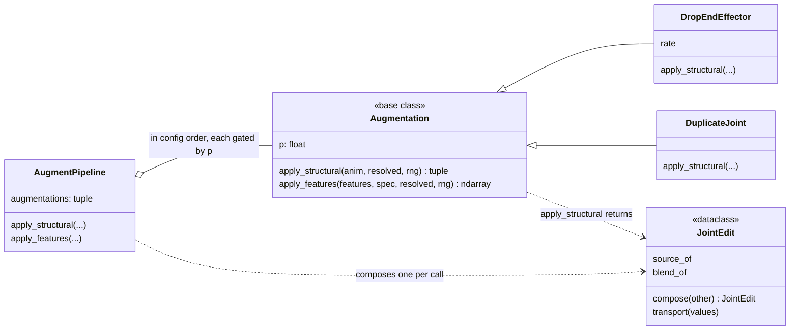

# augment

Per-sample augmentation, composed from config: structural edits that change
the skeleton before feature extraction (`DropEndEffector`, `DuplicateJoint`),
or edits in feature space after normalization. `JointEdit` carries per-joint
arrays (normalization statistics, the T-pose) through a structural edit, so
they are gathered rather than recomputed. Where augmentation runs in the read
path belongs to [data](../data/index.md); the reduction in
[features](../features/reduction.md) composes with the same `JointEdit`.

Configured in `configs/train.yaml` under `augmentations:`, each entry a full
`_target_` with its own `p`, because augmentations carry parameters a bare
name list can't. Each gate fires independently, so a sample can get both a
drop and a duplicate, unlike the reference's single exclusive draw.
`augmentations: []` turns augmentation off.

## Class diagram

Both hooks are no-ops on the base, so a subclass overrides only the one it
changes. `MotionDataset` builds the `AugmentPipeline` from the configured list
([data](../data/index.md)).

## Reference

::: poseydon.augment
    options:
      members: false

::: poseydon.augment.base

::: poseydon.augment.joint_edit

::: poseydon.augment.topology
