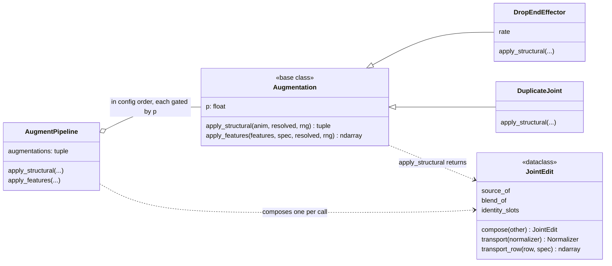

# augment

Per-sample augmentation, composed from config: structural edits that change
the skeleton before feature extraction (`DropEndEffector`, `DuplicateJoint`),
or edits in feature space after normalization. `JointEdit` carries per-joint
arrays (normalization statistics, the T-pose) through a structural edit, so
they are gathered rather than recomputed. An inserted joint averages its two
neighbours', except in the slots that hold its own rotation
(`identity_slots`): that rotation is identity on every frame, so those slots
are centred on identity and left unscaled, and normalize to exactly 0. Where augmentation runs in the read
path belongs to [data](../data/index.md); the reduction in
[features](../features/reduction.md) composes with the same `JointEdit`.

Configured in `configs/train.yaml` under `augmentations:`, each entry naming
its class by `type:` with its own `p`, because augmentations carry parameters
a bare name list can't. Each gate fires independently, so a sample can get both a
drop and a duplicate, unlike the reference's single exclusive draw.
`augmentations: []` turns augmentation off.

## Limitations

- **Under `rot6d_bone`, an inserted joint's own slot averages the wrong
  pair.** That slot holds its parent's rotation, the one its source joint's
  slot held, but `transport` averages the source joint's moments with the
  parent's, whose `rot6d_bone` slot holds the grandparent's rotation. The
  `rot6d_joint` default is unaffected. See [#10](https://github.com/LuCazzola/PoseYdon/issues/10).

## Class diagram

Both hooks are no-ops on the base, so a subclass overrides only the one it
changes. `MotionDataset` builds the `AugmentPipeline` from the configured list
([data](../data/index.md)).

## Reference

::: poseydon.augment
    options:
      members: false

::: poseydon.augment.base

::: poseydon.augment.joint_edit

::: poseydon.augment.topology
