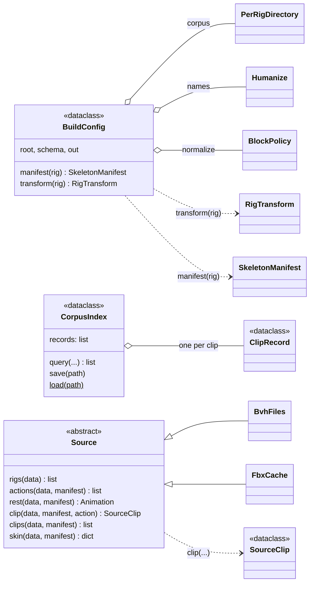

# build

Turning a raw corpus into a prepared, model-ready one, invertibly. `build` owns
every artefact under `data/truebones/rigs/` and `data/truebones/clips/`, one
writer per file. Stage 1, [preparation](preparation.md), turns source geometry
into canonical geometry and records the inverse in `preproc.npz`. Stage 2
(`src/poseydon/build/pipeline.py`) runs four passes, clip, skeleton, stats and
index, writing the clip `.npz`, `skeleton.npz`, `stats.npz` and `index.jsonl`.
Only `stats.npz` depends on the feature schema, so changing `features:` re-runs
one pass.

It reads files through [io](../io/index.md), reduces joints through
[features](../features/reduction.md) and computes statistics with
[data](../data/index.md)'s `Normalizer`; [data](../data/index.md) reads what it
writes, and [export](../export/index.md) inverts stage 1 to bring a generated
clip back to the source rig. Where stage 1 reads its raw clips from is a
registered `source:` (`src/poseydon/build/sources.py`): `bvh_files`, the raw
Truebones BVHs, or `fbx_cache`, UniMate's Truebones FBX clips as
`scripts/build_fbx_cache.py` cached them, with the skeleton rebuilt as Blender's
FBX importer would have. Driven by `scripts/process_dataset_truebones.py`
(stage 1) and `scripts/build_features.py` (stage 2).

## Limitations

- **A stage-1 change invalidates everything after it.** Nothing detects a
  stale corpus: rebuild stage 1, then stage 2, and retrain checkpoints trained
  on the old corpus.
- **The index leaves out clips shorter than two frames.** Velocity features
  need two frames, so such a clip (each authored `__TPOSE_authored.bvh`) has
  no feature frame; it is still written to `clips/`, as the rig's rest pose,
  and stage 2 warns once per clip. Anything that lists clips from disk instead
  of the index sees it.
- **`fbx_cache` approximates Blender's armature.** Bones are `eSkeleton` nodes
  or skin-cluster-linked nodes plus non-bone nodes between them; the largest
  tree is kept. Not modelled: Blender's bone re-orientation and FBX unit scale
  (clips stay in the file's units and axes); the joint sets are checked against
  UniMate's published lists only as a superset (they are pruned afterwards).
  Where a species' clips differ in joints, the largest group defines the rig
  and a clip missing one of its joints is left out (`FbxCache.dropped`).

## Class diagram

`BuildConfig` names everything one build needs; `transform(rig)` reads the
`RigTransform` that [preparation](preparation.md) fitted and persisted as
`preproc.npz`. `SkeletonManifest` is in [core](../core/index.md),
`BlockPolicy` in [data](../data/index.md).

## Reference

::: poseydon.build
    options:
      members: false

::: poseydon.build.authority

::: poseydon.build.corpus

::: poseydon.build.index

::: poseydon.build.names

::: poseydon.build.pipeline

::: poseydon.build.sources
