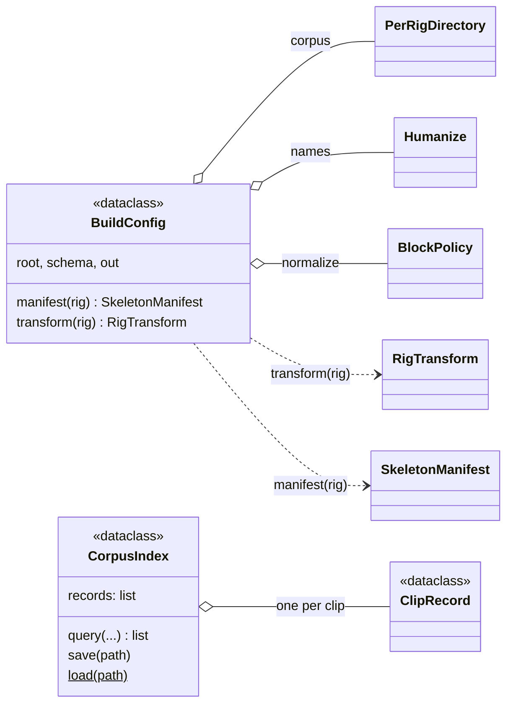

# build

Turning a raw corpus into a prepared, model-ready one, invertibly. `build` owns
every artefact under `data/truebones/rigs/` and `data/truebones/clips/`, one
writer per file. Stage 1, [preparation](preparation.md), turns source geometry
into canonical geometry and records the inverse in `preproc.npz`. Stage 2
(`src/poseydon/build/pipeline.py`) runs four passes, clip, skeleton, stats and
index, writing the clip `.npz`, `skeleton.npz`, `stats.npz` and `index.jsonl`.
Only `stats.npz` depends on the feature schema, so changing `features:` re-runs
one pass.

It reads files through [io](../io/index.md), reduces joints through
[features](../features/reduction.md) and computes statistics with
[data](../data/index.md)'s `Normalizer`; [data](../data/index.md) reads what it
writes, and [export](../export/index.md) inverts stage 1 to bring a generated
clip back to the source rig. Driven by `scripts/process_dataset_truebones.py`
(stage 1) and `scripts/build_features.py` (stage 2).

## Limitations

- **A stage-1 change invalidates everything after it.** Nothing detects a
  stale corpus: rebuild stage 1, then stage 2, and retrain checkpoints trained
  on the old corpus.

## Class diagram

`BuildConfig` names everything one build needs; `transform(rig)` reads the
`RigTransform` that [preparation](preparation.md) fitted and persisted as
`preproc.npz`. `SkeletonManifest` is in [core](../core/index.md),
`BlockPolicy` in [data](../data/index.md).

## Reference

::: poseydon.build
    options:
      members: false

::: poseydon.build.authority

::: poseydon.build.corpus

::: poseydon.build.index

::: poseydon.build.names

::: poseydon.build.pipeline
