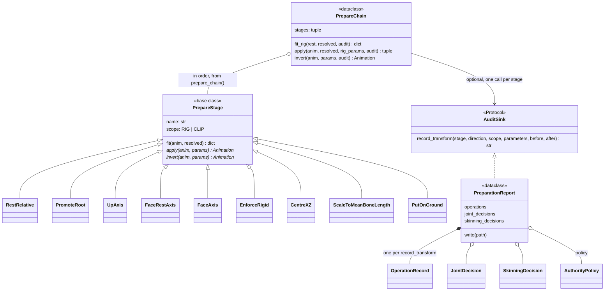

# build: preparation

Stage 1 of [build](index.md): an invertible chain of geometry stages, fitted on
the BVH and persisted with their parameters so a generated clip can return to
the user's rig. Rig-scoped stages fit once on the rest pose; clip-scoped ones
(`FaceAxis`) fit per clip. `report.json` records each transform and the
manifest's declared source authority. FBX enters only at export.

## Limitations

- **Facing is two stages, and only one turns the joints.** `FaceRestAxis`
  (rig) turns the whole rig so the rest skeleton faces +Z; `FaceAxis` (clip)
  turns only the root, so frame 0 faces +Z too. Every clip of a rig therefore
  shares one set of offsets and local frames, and the same pose has the same
  rotation features in every clip and across rigs. Turning the whole rig per
  clip (as `FaceAxis` did until 2026-10-13) gives each clip its own frame;
  nothing but the round-trip test's checks would notice it coming back.
- **The up axis is declared, not detected.** `UpAxis` turns the manifest's
  `up_axis:` (default `+Y`) to +Y; a BVH records none. A Z-up rig left at the
  default goes through on its side; stage 1 warns when the rest skeleton is
  not upright (`scripts/process_dataset_truebones.py`), which is a heuristic:
  it also fires on a facing pair that is not left/right (Crow).
- **Facing is measured after `EnforceRigid`.** Before it, a Biped clip's
  per-joint translations place joints elsewhere than its offsets, and a facing
  fitted there came out up to ~90° off (Ant, Bat, Bird) until 2026-10-13. A
  stage moved ahead of `EnforceRigid` that reads joint positions has the same
  problem.
- **One rigid geometry per rig is lossy by design.** `RestRelative` gives every
  clip the rest pose's offsets and `EnforceRigid` drops per-joint translation,
  so a clip's own bone vectors are gone: up to 25% of extent on some attack
  clips. A round trip shows that loss; it is not a bug.
- **`PromoteRoot`'s targets are not in the manifest.** They live in
  `PROMOTE_ROOT` in `scripts/process_dataset_truebones.py`, keyed by rig name;
  a new rig with a locator chain needs an entry there.

## Class diagram

`prepare_chain()` is the one definition of the stage order. `RigTransform`
(below) is the fitted parameters persisted as `preproc.npz`; `RigRecord`
reads it back to invert the chain ([export](../export/index.md)).
`AuthorityPolicy` is in [core](../core/index.md).

## Reference

::: poseydon.build.prepare

::: poseydon.build.report
