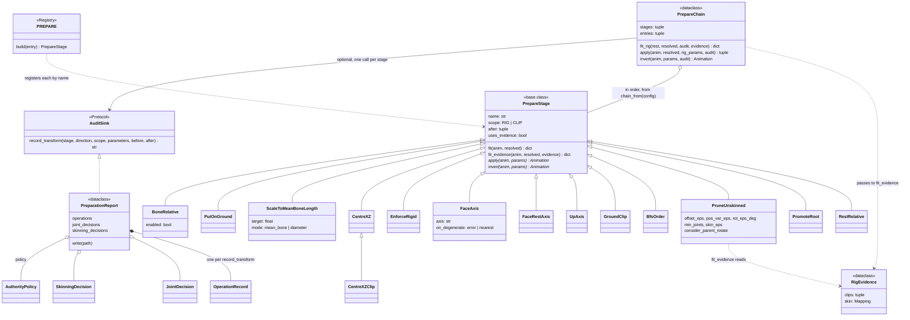

# build: preparation

Stage 1 of [build](index.md): an invertible chain of stages, fitted on the raw
clips and persisted with their parameters so a generated clip can return to the
user's rig. Preparation may clean up the rig (a stage may remove joints, and
records them); reduction is the model's lens
([below](#rig-cleanup-versus-the-models-lens)). Rig-scoped stages fit once on the rest pose; clip-scoped ones
(`FaceAxis`, and `CentreXZClip` and `GroundClip`, which UniMate's recipe uses) fit per clip. `report.json` records each transform and the
manifest's declared source authority. `fbx_cache` (Truebones, UniMate's recipe) reads FBX at stage 1, through the cache, and its rest pose is a bind pose (Truebones: of the rig's rest asset, `tools/build_rest_fbx.py`); a `bvh_files` source is read from the BVH only.

The chain is the dataset config's `prepare:` list, built in order from the
`PREPARE` registry by `type:` (`chain_from`). Every stage registers itself
under its `name`, which is also the key its parameters are stored under, so a
stage of one's own is a `PrepareStage` subclass with a `name`, imported through
`custom_imports`. Each stage declares in `after` which stages must precede it,
and `PrepareChain` refuses a chain that breaks one. `preproc.npz` records the
list it was built from (`RigTransform.chain`), and export inverts by that, not
by the config of the day.

Two rotation conventions come out of it. `rest_relative` makes identity on
every joint the rig's rest clip. `bone_relative`, which a dataset lists last
to use it, re-expresses that as LAFAN1 / 3ds Max Biped does: each joint's
local +X runs along its bone, so identity is a straight chain and X is twist
on every joint. World motion is the same either way; it exists to ablate the
convention (`data=truebones_bone`).

## UniMate's canonicalization, as options

`data=unimate` lists, after `prune_unskinned`: `bfs_order`, `enforce_rigid`
(UniMate rebuilds positions from rest offsets, only the root moves), `face_axis`
(`on_degenerate: nearest`), `centre_xz_clip`, `scale` (`mode: diameter`,
`target: 2.0`) and `ground_clip`, UniMate's `canonicalize_anim` order (facing,
centre XZ, scale, ground). Each is an option or sibling of an existing stage, so
`data=truebones` is unchanged.

- `BfsOrder` (`src/poseydon/build/cleanup.py`) renumbers joints breadth-first from
  the root, children by subtree size (largest first) then rest offset length
  (shortest first), as `bfs_reorder_joints`. It stores the permutation and the BFS
  names; `invert` restores the source order exactly and also accepts a BVH read
  back, whose joints come depth-first, by putting them in the stored BFS order by
  name first.
- `ScaleToMeanBoneLength.mode: diameter` scales the longest bone-length path between
  two joints to `target`, found by two sweeps from the root (`get_skeleton_diameter`).
  Zero-length End Sites add nothing to a path (`tree_diameter`).
- `FaceAxis.on_degenerate: nearest` takes the first frame whose facing pair has a
  horizontal component above 1e-6 (`FACING_EPS`) when frame 0's does not; `error`
  (default) keeps refusing.
- `CentreXZClip` puts each clip's root frame-0 XZ at the origin; `GroundClip` puts
  each clip's lowest joint over all its frames at y = 0 (UniMate's `per_motion`).
  `GroundClip` erases the height difference between a crouch and a stand, which
  `PutOnGround` avoids by being rig-scoped; the choice is UniMate's, rationale not
  recorded.

Measured with stage 1 on Alligator, Anaconda and Horse: the frame-0 facing is
along +Z in every clip (dot 1.0000), and the rest diameter is 2.0. Anaconda's
`extra_yaw_deg: +90` was checked on its 18 clips: head minus tail, projected on XZ,
points to +Z (dot 1.0000 in every clip).

## Rig cleanup versus the model's lens

Two groups of operations can change a rig's joint set, and the config keeps them
in two lists. The owner considered merging them into one `preproc` list and chose
to keep them separate, because separate groups keep the operations logically
distinct instead of one giant list.

- **Rig cleanup, `prepare:` (baked into the prepared corpus).** Removing what is
  not part of the character: IK controls, helpers, an unskinned ground locator.
  A property of the asset. `prune_unskinned` (`src/poseydon/build/cleanup.py`) is
  the first stage that removes joints other than `promote_root`; it records each
  removed joint by name with its bind pose, as the other stages record their
  parameters, and decides from the whole rig, so it reads every clip and the skin
  weights (`RigEvidence`, handed to `PrepareChain.fit_rig` by
  `scripts/process_dataset_truebones.py`).
- **The model's lens, `reduce:` (applied when features are read).** Which of the
  character's remaining joints a model sees under a given feature layout
  (`drop_end_sites`, `fold_into_root`, `drop_still`). It depends on the layout, so
  it stays out of the corpus ([features: reduction](../features/reduction.md)).

What the split preserves: one prepared corpus serves several feature layouts and
reduction rule sets; the prepared level stays a full-character artifact (export
`--representation prepared`, inspection in a DCC tool, its own round-trip check);
a reduction rule that fits on every prepared clip of a rig (`drop_still`) sees
settled geometry; and changing `reduce:` reruns stage 2 only. The contract is
therefore "preparation may clean up the rig (recorded); reduction is the model's
lens", where it used to be "preparation keeps structure".

A cleaned rig is a new joint set for everything after it in the chain, which is
why `prune_unskinned` is ordered after `up_axis` and before the geometry stages:
`_rebind` re-resolves the manifest against the surviving joints.

## Limitations

- **Removed joints come back at their bind pose, with no motion.** `prune_unskinned`
  records each removed joint's rest local translation and rotation; `invert`
  reinserts it there. The child of a merged pass-through joint (or of a folded
  root) takes the composite, so it and its subtree are world-exact for the stage alone (after `enforce_rigid` the subtree moves by about the offset times the angle between the joint's rotation and its bind); the removed
  joint itself is not what it was in any clip. This is the owner's decision. The
  tests that choose what to remove read the clips of the source, so a prepared
  corpus cannot be re-pruned from itself.
- **`prune_unskinned` needs skin weights.** A `bvh_files` source has none
  (`Source.skin` is `None`) and the stage raises; it applies to `fbx_cache`, where a
  rig with no skin mesh counts as all joints unskinned (an empty mapping, as UniMate
  treats it). It also raises if the rest pose's translations differ from its offsets,
  which `invert` relies on. On the
  full cache the kept joint sets equal UniMate's `joint_names.json` on all 74 rigs
  (`--check-against`, `docs/index/tooling.md`).

- **Facing is two stages, and only one turns the joints.** `FaceRestAxis`
  (rig) turns the whole rig so the rest skeleton faces +Z; `FaceAxis` (clip)
  turns only the root, so frame 0 faces +Z too. Every clip of a rig therefore
  shares one set of offsets and local frames, and the same pose has the same
  rotation features in every clip and across rigs. Turning the whole rig per
  clip (as `FaceAxis` did until 2026-10-13) gives each clip its own frame;
  nothing but the round-trip test's checks would notice it coming back.
- **The up axis is declared, not detected.** `UpAxis` turns the manifest's
  `up_axis:` (default `+Y`) to +Y; a BVH records none. A Z-up rig left at the
  default goes through on its side; stage 1 warns when the posed rest frame is
  not upright (`scripts/process_dataset_truebones.py`), which is a heuristic:
  it also fires on a facing pair that is not left/right (Crow's, until
  2026-10-16). Until 2026-10-20 it read the offsets alone, which on
  `data=unimate` (no `rest_relative`) are not the rest pose and falsely
  flagged Raptor3, Roach, Crab and Jaws.
- **Facing is measured after `EnforceRigid`.** Before it, a Biped clip's
  per-joint translations place joints elsewhere than its offsets, and a facing
  fitted there came out up to ~90° off (Ant, Bat, Bird) until 2026-10-13. A
  stage moved ahead of `EnforceRigid` that reads joint positions has the same
  problem.
- **The `ground` stage's `mesh` mode reads a cache the build cannot make.** The FBX SDK is
  x86-64 only, so `tools/build_rest_fbx.py` (the `fbxsdk` service) writes each
  rig's rest-pose mesh (its rest asset's mesh at bind) to `cache/rigs/<Rig>/rest_mesh.npz` under the dataset (`rig_cache` in `poseydon.build.corpus`), and
  `PutOnGround` maps it onto the rest joints by a best-fit similarity. A rig
  whose cache is missing, or was made for another `rest_pose:`, is grounded on
  its lowest joint and the build prints a warning; it does not fail. A changed
  `rest_pose:` therefore needs the tool rerun for that rig. The two modes also
  differ in what they read: `joints` takes the lowest joint over every frame of
  the rest clip, `mesh` the first frame only.
- **Foot contact is still measured from y = 0.** `foot_contact` flags a foot
  joint within `contact.max_height` (0.30, about 1.4 mean bone lengths) of the
  floor; on a mesh floor every foot joint sits above it by its sole's
  thickness, which eats into that margin.
- **One rigid geometry per rig is lossy by design.** `RestRelative` gives every
  clip the rest pose's offsets and `EnforceRigid` drops per-joint translation,
  so a clip's own bone vectors are gone: up to 25% of extent on some attack
  clips. A round trip shows that loss; it is not a bug.
- **`BoneRelative`'s frames are a rule, not authored.** `bone_frames` picks
  each joint's +X child as the non-zero child with the most descendants
  (longest on a tie) and carries +Y down from the parent; a fork's other
  children keep off-axis offsets. Whether that picks the anatomically right
  child (spine over legs at the pelvis) was not inspected rig by rig.
- **Only the end of the chain may see bone-relative rotations.** Every stage
  that fits on the rest skeleton (`FaceRestAxis`, the script's checks) reads
  it as offsets under identity rotations; a stage moved after `BoneRelative`
  that does the same fits on a straight chain.
- **A snake's facing pair runs along the body.** Anaconda has no left/right
  pair, so its pair is `BN_Neck`/`BN_Head` with `extra_yaw_deg: -90`; that
  turns the across-body axis into the head's direction. Its old pair (tail tip
  and tongue) faced the rig 90° off +Z until 2026-10-16.
- **The order check covers only what stages declare.** `after` lists the
  orderings known to matter (see each stage); a reordering nobody recorded a
  reason against passes the check and may still change the result.
- **A corpus built before 2026-10-19 records no chain.** Its `preproc.npz`
  lacks `__chain__`, so `RigTransform.prepare_chain` (and with it export)
  refuses it; rebuild stage 1.

- **A BVH lists joints depth-first, so `bfs_order` does not show on disk.**
  `BfsOrder.invert` copes by name; anything reading prepared BVHs and expecting
  UniMate's joint order has to reorder.
- **`ground_clip` and `centre_xz_clip` are fitted on the rest pose too.** `fit_rig`
  fits clip-scoped stages on the rest; their rest values are kept, and
  `RigRecord.restore(facing_from=None)` uses the rest-fitted `centre_xz_clip` and
  `ground_clip` values for a generated clip.
- **A clip cut by `max_length` may sit above y = 0.** `ground_clip` grounds each
  clip on its whole source motion, before `clips:` trims and crops it, as UniMate's
  `_process_motion_file` does (per-motion grounding, then `trim_static_ends`, then
  windowing). On `data=unimate` 14 clips keep their lowest joint above 0, all cut to
  200 frames; worst is Trex `Long_Death` at 0.10 (diameter 2). Truebones grounds per
  rig instead (`ground`, rig-scoped), which keeps cropped clips on the floor but
  departs from UniMate.

## Class diagram

The dataset config's `prepare:` list is the one definition of the stage order.
`RigTransform` (below) is the fitted parameters and that list, persisted as
`preproc.npz`; `RigRecord` reads it back to invert the chain
([export](../export/index.md)).
`AuthorityPolicy` is in [core](../core/index.md).

## Reference

::: poseydon.build.prepare

::: poseydon.build.cleanup

::: poseydon.build.report
