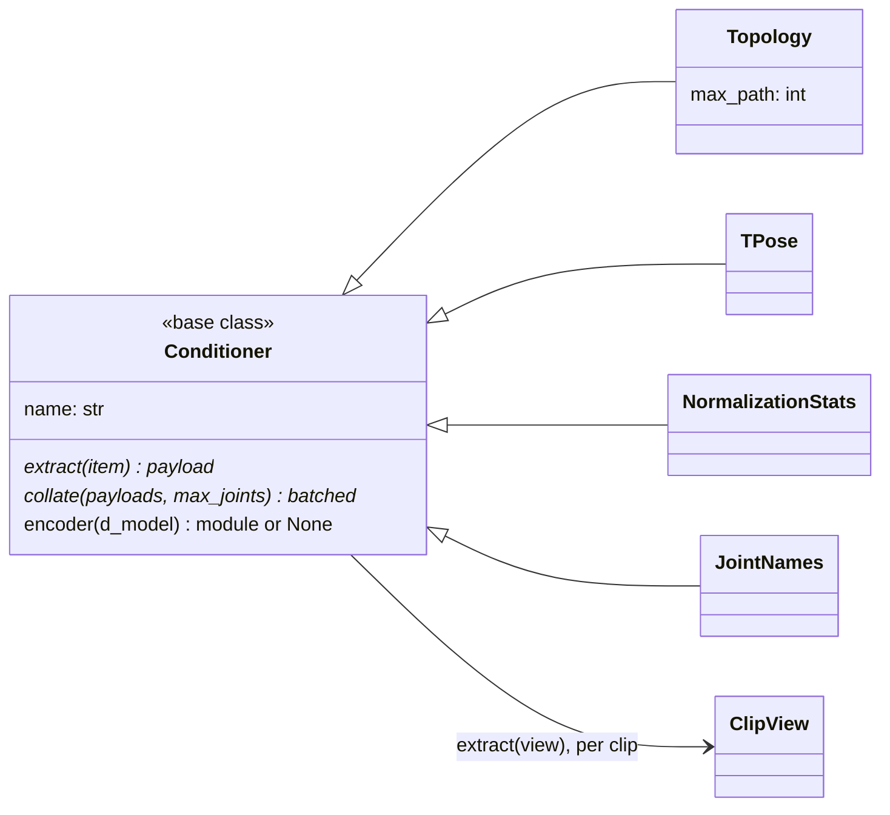

# conditioners

Declared conditioning: each extra signal a batch may carry, with its whole
path, extracted per item from a `ClipView`, collated across the batch with
joint padding, and optionally a default encoder. The shipped ones are all
skeleton-derived: `topology`, `tpose`, `norm_stats`, `joint_names`. Only
declared conditioners are loaded, so an unconditional corpus declares none.

How a model injects a signal stays in [models](../models/index.md), and so does
conditioning dropout for guidance. The batch type, `Cond`, is in
[core](../core/index.md). Declared as `conditioners:` in `configs/train.yaml`
and `configs/sample.yaml`; the list is recorded in the checkpoint recipe and a
mismatch raises at sampling ([training](../training/index.md)).

## Limitations

- **AnyTop ignores `joint_names` unless `name_embedding_dim: 768` is set**
  (`configs/model/anytop.yaml`): its projection stays `None` and the embeddings
  are dropped without a warning. `MoDiffAE` wires names differently, and
  passing it the same key raises (`configs/model/modiffae.yaml`).
- **`topology` reads the clip's own offsets**, which differ between clips of a
  rig ([preparation](../build/preparation.md#limitations)), so the clip you
  template on matters.

## Class diagram

`encoder` defaults to `None`; how the payload is injected stays with the
model. `MotionDataset` builds one of each configured name from `CONDITIONERS`
and calls `extract` on the `ClipView` it assembles ([data](../data/index.md)).

## Reference

::: poseydon.conditioners
    options:
      members: false

::: poseydon.conditioners.base

::: poseydon.conditioners.skeleton
