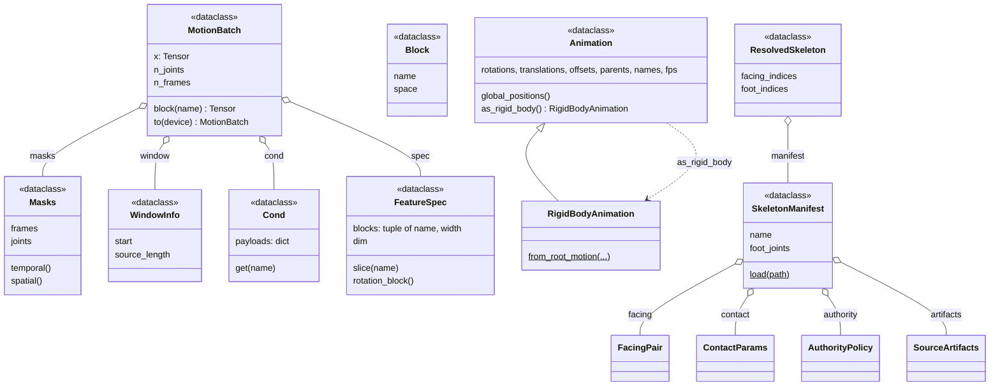

# core

The contracts every other package is written against: the animation
containers, skeleton manifests, the named feature layout (`FeatureSpec`), the
batch handed to a model (`MotionBatch`), kinematics and rotation math, and the
`Registry` behind every list-valued config slot. `core` imports nothing else
from `poseydon`, and every other package imports it.

Two animation types exist on purpose: `Animation` keeps whatever a file
declares, any joint may translate, and `RigidBodyAnimation`, only the root
translates, is what everything downstream asks for, reached through a checked
`as_rigid_body`. Manifests name joints in YAML rather than by index, so a
re-exported rig fails loudly. A batch carries only the tensor, its spec, the
masks and the window; everything else is a declared conditioner in `Cond`
([conditioners](../conditioners/index.md)).

## Limitations

- **Two 6D layouts, and mixing them inverts rotations silently.**
  `matrix_to_rot6d` takes the first two rows by default (PyTorch3D); the
  feature blocks pass `layout="columns"`, the reference's
  (`src/poseydon/features/kinematics.py`). Quaternions are scalar-last
  `(x, y, z, w)` throughout.
- **`Cond.to` moves tensors, mappings, lists and tuples, and nothing else.** A
  payload of any other container stays on the CPU with no error.

## Class diagram

The classes drawn are frozen records: the contracts the other packages pass
around. Left off: `Registry` (the name-to-class table every package's
factory uses), `EdgeType`, and the error types. `collate`
([data](../data/index.md)) builds the `MotionBatch` and its parts. `Block` is
how a loss names the feature block it needs ([losses](../losses/index.md));
`FeatureSpec` itself stores plain `(name, width)` pairs.

## Reference

::: poseydon.core
    options:
      members: false

::: poseydon.core.animation

::: poseydon.core.authority

::: poseydon.core.batch

::: poseydon.core.kinematics

::: poseydon.core.registry

::: poseydon.core.rotations

::: poseydon.core.skeleton

::: poseydon.core.spec

::: poseydon.core.topology

::: poseydon.core.torch_kinematics
