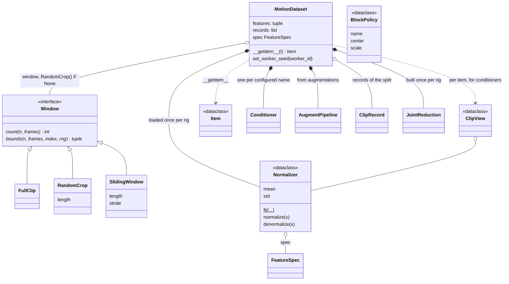

# data

The read path: a prepared corpus to normalized feature windows, collated into
a `MotionBatch` ([core](../core/index.md)). Per item, `MotionDataset` loads
`clips/<Rig>/<action>.npz`, applies the rig's reduction from `skeleton.npz`,
then any augmentations ([augment](../augment/index.md)), extracts the
configured features ([features](../features/index.md)), normalizes with
`stats.npz` (transported through the augmentation's `JointEdit`), and crops a
window. `collate` pads to the batch's own maxima; `balanced_weights` gives
every rig an equal share of samples.

`data` also owns the statistics' format and policy (`Normalizer`,
`BlockPolicy`): stage 2 fits and saves them ([build](../build/index.md)), the
dataset only loads them, and retargeting uses them to denormalize. The policy
per block is declared in `configs/dataset/truebones.yaml`; the window in
`configs/data/`. It does not own writing the corpus, what a feature or a
conditioner is ([conditioners](../conditioners/index.md)), or the DataLoader
and worker setup (`src/poseydon/training/lightning.py`,
[training](../training/index.md)).

## Class diagram

`BlockPolicy` says how one feature block is centred and scaled when the
statistics are fitted at build time ([build](../build/index.md)'s
`BuildConfig.normalize`). `collate` turns a list of `Item` into a `MotionBatch`
([core](../core/index.md)).

## Reference

::: poseydon.data
    options:
      members: false

::: poseydon.data.collate

::: poseydon.data.dataset

::: poseydon.data.normalize

::: poseydon.data.sampler

::: poseydon.data.window
