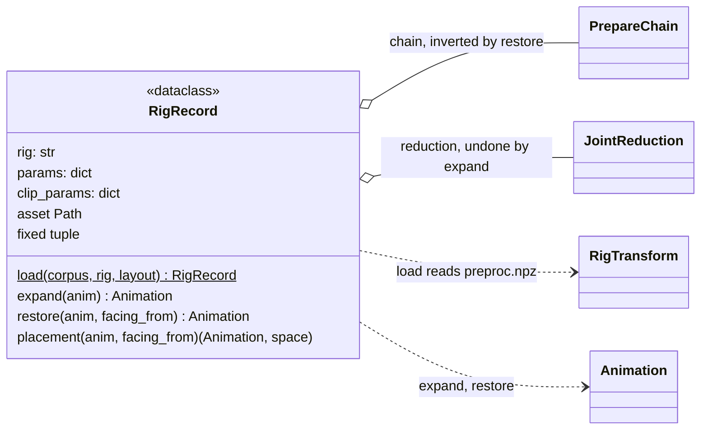

# export

The last arrow of the pipeline: reduced canonical motion back onto a
character. `RigRecord` loads what the corpus recorded about one rig (its
reduction, its preparation parameters from `preproc.npz`, and its rest asset,
`<corpus>/cache/rigs/<Rig>/rest.fbx`: the vendor FBX re-bound to the rest pose by
`tools/build_rest_fbx.py`) and moves a clip between the model view, prepared
space and source space. A source FBX dataset (`fbx_cache`: truebones, unimate)
reads its clips in the FBX's own space, so a restored clip drives the asset's
nodes by name, with no calibration; a prepared clip is placed in canonical space
by one similarity solved on the clip (`RigRecord.placement`).
It writes nothing: `BVH.from_animation` or `FBX.from_animation`
([io](../io/index.md)) write whatever animation they are given, so the space a
clip is in decides what the file holds. The space is stated by the caller,
never stored on the animation. FBX export runs only in the `fbxsdk`
container; BVH works anywhere.

It does not own the transforms it inverts (`build.prepare`,
[build: preparation](../build/preparation.md); `features.reduce`,
[features: reduction](../features/reduction.md)). Called by `poseydon export
--representation prepared|source --format bvh|fbx`,
`scripts/build_stage_samples.py` and `tests/test_roundtrip.py`.

## Spaces

| space | joints | frame | get it with | BVH | FBX |
|---|---|---|---|---|---|
| **model view** | reduced, exactly the model's | canonical: +Z, scaled, centred, grounded | the model's output | `BVH.from_animation(anim)` | expand first: the mesh needs every node |
| **prepared** | every joint | canonical | `record.expand(model)`, or a corpus clip | `BVH.from_animation(anim)` | `FBX.from_animation(*record.placement(anim), ...)`: `placement` restores the clip and returns the similarity that puts the asset, mesh and skin, in canonical space (`FBX.from_animation(restored, record.asset, space)`) |
| **source** | the source's own | source units, frame, names | `record.restore(anim, facing_from=...)` | `BVH.from_animation(anim, channels=record.source_channels)` | `FBX.from_animation(anim, record.asset)`: the rest asset in its own space |

`record.source_channels` is `None` (the writer's default layout) where the source
has no CHANNELS layout (`fbx_cache`: `EnforceRigid` then records `inferred`) or the
recorded one is for another skeleton: `data=unimate` infers it on the pruned,
BFS-ordered joints, while a restored clip has every removed joint back, in source order.

Every FBX carries the rig's mesh; there is no bare-skeleton FBX
(`poseydon export --bare-skeleton` writes BVH only). Joints the reduction
dropped are driven by `invert_reduction`'s reconstruction.

## Limitations

- **A model view written as BVH has no rotation for its leaves** (by design,
  not a bug). Under `rot6d_joint` the reduction drops zero-length End Sites,
  so a joint like Dog's ear `Bip01_Ponytail21` is a leaf of the model view,
  and a BVH leaf has no channels (Dog: 8 such leaves, Bear: 27; none under
  `rot6d_bone`). The model still sees and generates those rotations, and
  `restore`/`expand` put the End Sites back, so a source or FBX export from
  the animation keeps them; the model-view `.bvh` is a debug view.
  `poseydon export` warns when it is given one. An FBX made from that BVH holds those nodes, and the mesh they
  skin, at rest. Export from the `.anim.npz` that `sample` and `retarget` write
  beside the BVH, which keeps them.
- **A clip in the wrong space with the right joints writes at the wrong place
  and scale.** `FBX.from_animation` raises when no joint names a node, but
  nothing in a clip tells prepared from source (their joints nearly coincide),
  so passing it a prepared clip without `placement` is not caught.
- **Joints held by structure stay at the asset's rest transform in an FBX.**
  `RigRecord.fixed` (the chain above a promoted root, its dead branches, and
  the roots rig cleanup removed) is passed to `FBX.from_animation`, so those
  nodes keep the rest asset's local transform while the body's root is driven
  absolutely. `restore` cannot give them their clip values (only their product
  was observable): its chain follows the body (Crow's came back 30.9 units off
  under a root travelling 208), which a BVH must keep. A locator placed
  differently in the rest file than in a clip (Crow's `N_ALL`) sits where the
  rest file has it; nothing is skinned to it.
- **Animated node scale is lost.** An `Animation` carries no scale, so an FBX
  export holds every node at the asset's scale: Bear's `feast` and `groundpaw`
  squash `NPC_Neck1` by up to 3.5%, and the export does not. Nothing in the
  pipeline warns about it.
- **A dataset whose motion is not read from FBX has no FBX export.**
  `RigRecord.asset` needs `rest.fbx`, which `tools/build_rest_fbx.py` builds only
  for `fbx_cache` datasets; a BVH-only rig has no mesh to drive.
- **The rest asset's mesh is the vendor mesh re-skinned into the rest pose.**
  Linear blend skinning does not compose, so a vertex weighted to two bones
  that turn relative to each other between the vendor bind and the rest pose
  deforms differently from the vendor asset (`FBX.rebind`); measured per rig
  by `tools/build_rest_fbx.py --check`: single-bone vertices are exact, blended
  ones move up to 5.4e-2 of the extent on rigs whose rest pose is far from the
  vendor bind (most authored T-poses), and below 1e-6 where the rest pose is
  the vendor's bind (Horse). Mesh fidelity to the vendor asset is not asserted
  by any test.
- **`restore()` without `facing_from` restores the rest pose's facing.** A
  generated clip has no recorded heading, so it comes back on the source rig
  heading the way the rest pose did; pass `facing_from=<action>` to borrow a
  recorded clip's. Only the root's heading depends on it: `FaceAxis` turns
  only the root, so the skeleton itself always lands on the source bind.

## Class diagram

`RigRecord` holds no file: `restore` returns a plain `Animation`, and
`BVH.from_animation` / `FBX.from_animation` ([io](../io/index.md)) write it.
`PrepareChain` and `RigTransform` are in [build: preparation](../build/preparation.md),
`JointReduction` in [features: reduction](../features/reduction.md).

## Reference

::: poseydon.export
    options:
      members: false

::: poseydon.export.rig
