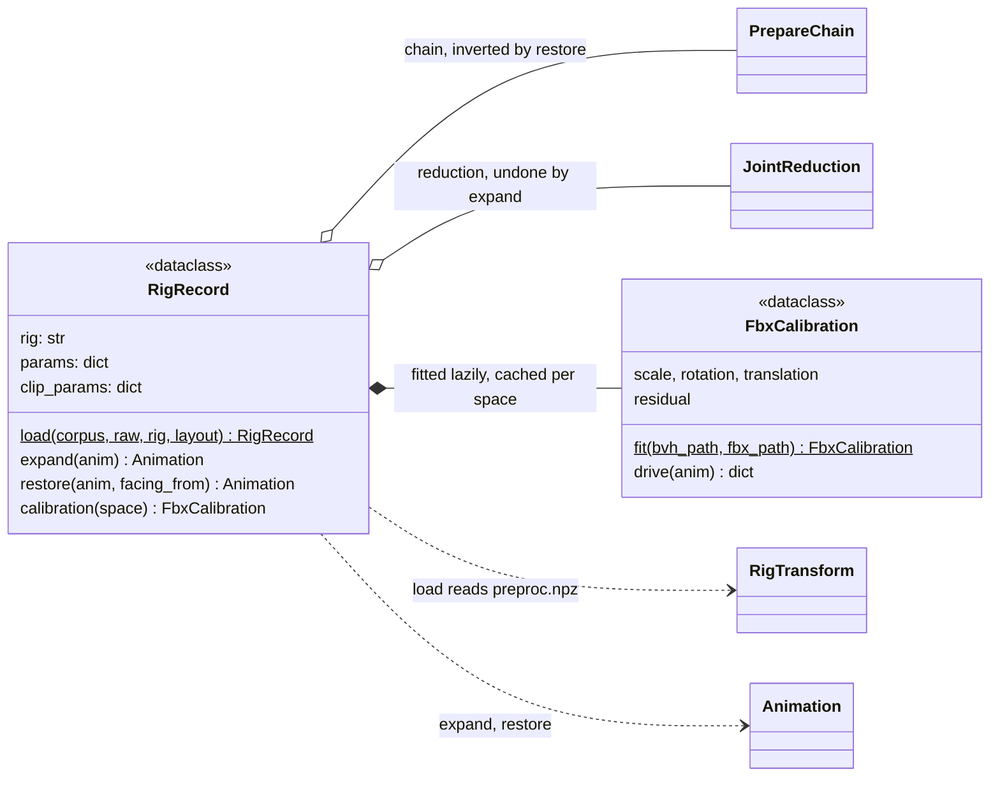

# export

The last arrow of the pipeline: reduced canonical motion back onto a
character. `RigRecord` loads what the corpus recorded about one rig (its
reduction, its preparation parameters from `preproc.npz`, and its FBX
calibrations, fitted from the vendor files under `data/_raw/<dataset>/source/<Rig>/`)
and moves a clip between the model view, prepared space and source space.
It writes nothing: `BVH.from_animation` or `FBX.from_animation`
([io](../io/index.md)) write whatever animation they are given, so the space a
clip is in decides what the file holds. The space is stated by the caller,
never stored on the animation. FBX export runs only in the `fbxsdk`
container; BVH works anywhere.

It does not own the transforms it inverts (`build.prepare`,
[build: preparation](../build/preparation.md); `features.reduce`,
[features: reduction](../features/reduction.md)). Called by `poseydon export
--representation prepared|source --format bvh|fbx`,
`scripts/build_stage_samples.py` and `tests/test_roundtrip.py`.

## Spaces

| space | joints | frame | get it with | BVH | FBX |
|---|---|---|---|---|---|
| **model view** | reduced, exactly the model's | canonical: +Z, scaled, centred, grounded | the model's output | `BVH.from_animation(anim)` | expand first: the mesh needs every node |
| **prepared** | every joint | canonical | `record.expand(model)`, or a corpus clip | `BVH.from_animation(anim)` | `FBX.from_animation(anim, record.calibration("prepared"))`: the vendor asset, mesh and skin, placed in canonical space |
| **source** | the source's own | source units, frame, names | `record.restore(anim, facing_from=...)` | `BVH.from_animation(anim, channels=record.source_channels)` | `FBX.from_animation(anim, record.calibration("source"))`: the vendor asset in its own space |

Every FBX carries the rig's mesh; there is no bare-skeleton FBX
(`poseydon export --bare-skeleton` writes BVH only). Joints the reduction
dropped are driven by `invert_reduction`'s reconstruction.

## Limitations

- **A model view written as BVH has no rotation for its leaves** (by design,
  not a bug). Under `rot6d_joint` the reduction drops zero-length End Sites,
  so a joint like Dog's ear `Bip01_Ponytail21` is a leaf of the model view,
  and a BVH leaf has no channels (Dog: 8 such leaves, Bear: 27; none under
  `rot6d_bone`). The model still sees and generates those rotations, and
  `restore`/`expand` put the End Sites back, so a source or FBX export from
  the animation keeps them; the model-view `.bvh` is a debug view.
  `poseydon export` warns when it is given one. An FBX made from that BVH holds those nodes, and the mesh they
  skin, at rest. Export from the `.anim.npz` that `sample` and `retarget` write
  beside the BVH, which keeps them.
- **A clip in the wrong space with the right joints writes at the wrong place
  and scale.** `FbxCalibration.drive` raises on missing joints, but nothing in
  a clip tells prepared from source (their joints nearly coincide), so passing
  `calibration("source")` a prepared clip is not caught.
- **`restore()` without `facing_from` restores the rest pose's facing.** A
  generated clip has no recorded heading, so it comes back on the source rig
  heading the way the rest pose did; pass `facing_from=<action>` to borrow a
  recorded clip's. Only the root's heading depends on it: `FaceAxis` turns
  only the root, so the skeleton itself always lands on the source bind.

## Class diagram

`RigRecord` holds no file: `restore` returns a plain `Animation`, and
`BVH.from_animation` / `FBX.from_animation` ([io](../io/index.md)) write it.
`PrepareChain` and `RigTransform` are in [build: preparation](../build/preparation.md),
`JointReduction` in [features: reduction](../features/reduction.md).

## Reference

::: poseydon.export
    options:
      members: false

::: poseydon.export.rig
