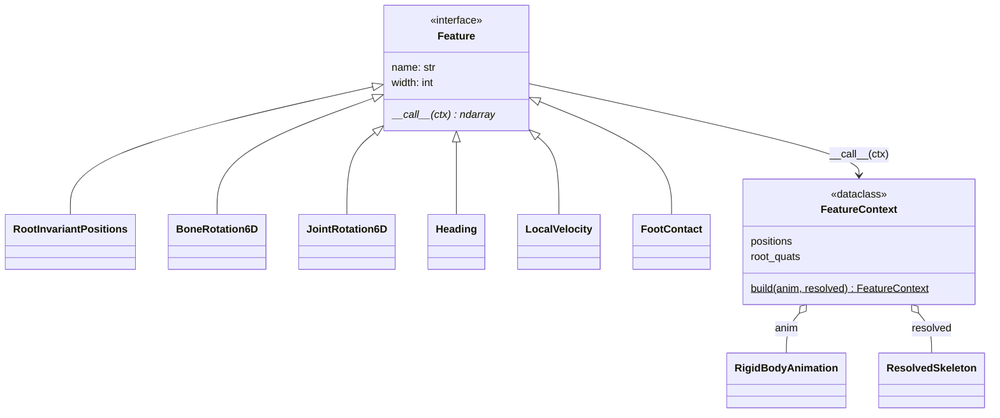

# features

Composable per-joint feature blocks: a `RigidBodyAnimation` to a
`(frames, joints, dim)` array plus its `FeatureSpec` ([core](../core/index.md)).
Features are pure functions of the canonical animation, named in the
`FEATURES` registry, so changing `features:` (`configs/train.yaml`,
`configs/sample.yaml`) needs no re-preparation, only stage 2's stats pass. A
new representation is one class plus a decorator. The default schema
`[ric_pos, rot6d_joint, heading, local_vel, foot_contact]` is 15 dims per joint.

The package also owns the way down and back: [reduction](reduction.md) (the
joints the model looks through) and [reconstruction](reconstruction.md)
(features back to a skeleton). It does not own normalization
([data](../data/index.md)) or the IK solver ([solvers](../solvers/index.md)).
Feature arrays feed [data](../data/index.md) and stage 2's stats pass
([build](../build/index.md)).

## Two rotation layouts

The rotation layout is chosen by naming one rotation block in the dataset's
`schema:` (`configs/dataset/<name>.yaml`) and the same blocks in `features:`
(`configs/train.yaml`, `configs/sample.yaml`):

| block | slot `j` holds | root slot | heading | leaves the reduction may drop |
|---|---|---|---|---|
| **`rot6d_joint`** (default) | joint `j`'s own local rotation | the root's rotation, in the heading frame | the `heading` block (cos, sin of the yaw, on the root) | every zero-length End Site |
| **`rot6d_bone`** (HumanML3D) | `parent(j)`'s rotation, orienting the bone that ends at `j` | the heading | in the root slot | a zero-length End Site only if it has a sibling |

They are different representations, not interchangeable, and the reduction
treats them differently. Both keep every joint that has a rotation of its own:
each drops only zero-length End Sites (which never rotate: 0° on every
Truebones clip), plus the one root fold the two share
([reduction](reduction.md)). Where they differ is which End Sites hold
something: `rot6d_bone` keeps a joint's rotation in its children's slots, so a
zero-length End Site that is its parent's only child holds the only copy of
the parent's rotation and is kept; under `rot6d_joint` it holds nothing and
goes. Measured on Truebones (4547 joints), `rot6d_joint` keeps 3493 (drops
23%) and `rot6d_bone` 4501 (drops 1%); Dog: 53 against 65 of 65.
`rot6d_joint` is the default; `rot6d_bone` is kept for parity with the
reference.

Switching layouts changes the reduction, which `skeleton.npz` records, so run
`scripts/build_features.py` in full, not `--stats-only`, then pass the same
layout to `RigRecord.load(..., layout=...)` / `poseydon export --layout`.
Checkpoints trained on the old `rot6d` block are the `rot6d_bone` layout:
their recipe names `rot6d`, which no longer exists, so loading one fails with
an "unknown feature" error until the recipe says `rot6d_bone`.

## Class diagram

`extract_features` builds one `FeatureContext` per clip and calls each named
`Feature` on it. Going back from features is on
[reconstruction](reconstruction.md); dropping degenerate joints on
[reduction](reduction.md). `RigidBodyAnimation` and `ResolvedSkeleton` are in
[core](../core/index.md).

## Reference

::: poseydon.features
    options:
      members: false

::: poseydon.features.base

::: poseydon.features.contact

::: poseydon.features.extract

::: poseydon.features.kinematics
