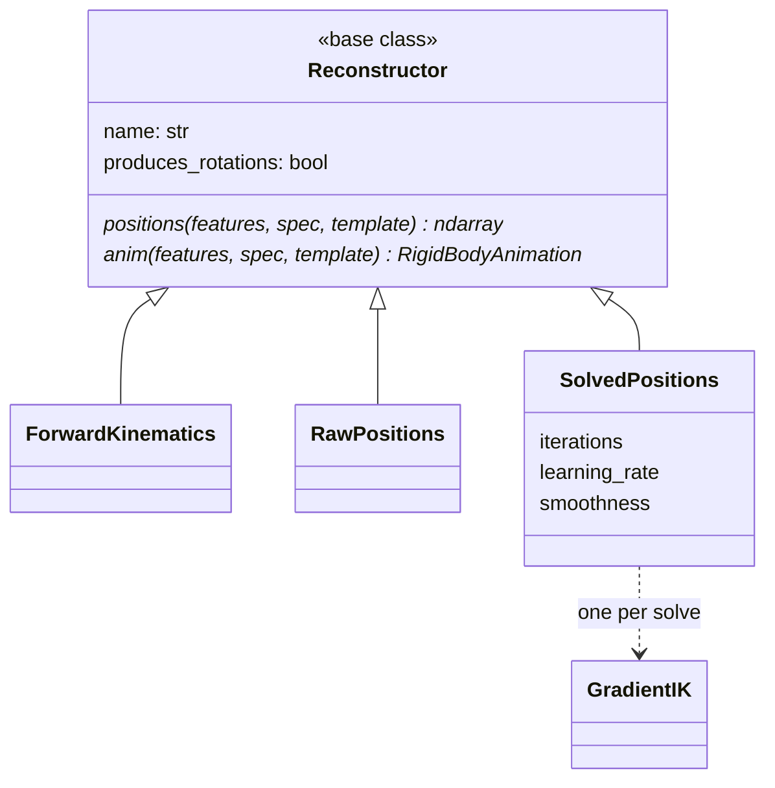

# features: reconstruction

Features back to positions or an animation. `recover` is exact: the rotations
are in the representation, so there is nothing to solve. Generated clips,
though, can have positions and rotations that disagree by more than three bone
lengths, so `reconstruct` makes the strategy a named choice: `fk` is rigid and
free, `positions` follows the prediction but stretches limbs and has no
rotations to write, and `positions_ik` (what the reference writes) refits the
positions onto a rigid skeleton with IK ([solvers](../solvers/index.md)). The
default comes from the recipe; `ops/retarget_run.py`, `poseydon sample` and
`training/metrics.py` call it.

## Limitations

- **`positions_ik` cannot see twist.** Rotation about a bone's own axis does
  not move its children, so the solve plateaus around 1% of a bone length on
  average and around 15% for the worst joint, and never converges to zero.

## Class diagram

`Reconstructor.anim` raises `NotImplementedError` on the base: `RawPositions`
has positions only, and no rotations to animate a rig with. `recover` (below)
holds the functions that read positions and rotations back out of a feature
vector. `GradientIK` is in [solvers](../solvers/index.md).

## Reference

::: poseydon.features.reconstruct

::: poseydon.features.recover
