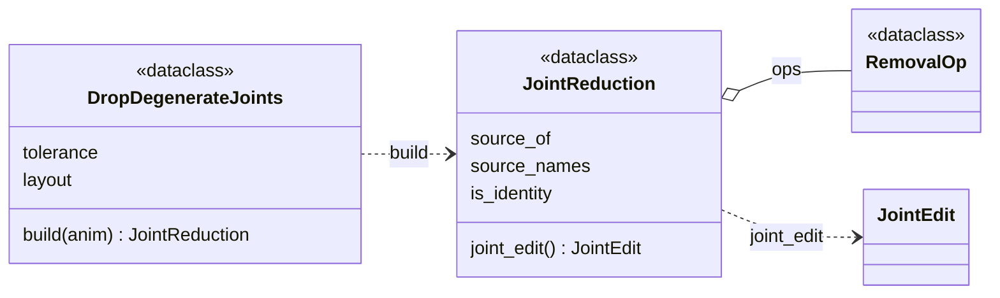

# features: reduction

Dropping joints that carry nothing learnable, and putting them back. The
reduction is applied at extraction time and never baked into the corpus: the
corpus keeps every joint, because skin weights are indexed by the original
joint order and a generated clip must come back on the user's rig. Which
joints drop depends on the rotation layout
([Two rotation layouts](index.md#two-rotation-layouts)).

## Limitations

- **A joint with a rotation of its own is never removed, with one exception.**
  Only End Sites (leaves of the FULL rig) drop, so a real joint that becomes a
  leaf once its End Site goes stays (Bear's `NPC_*Arm2_ForearmTwist2`,
  Scorpion's `Bip01_Neck1`). The exception is the COLLAPSE fold, done only
  into the root: the folded joint comes back exact, but the root's own world
  rotation does not (`Hips` in 46 Truebones rigs, off by up to 141° on Eagle).
  The fold is wanted: some rigs carry an extra root joint (`Hips` above a
  coincident `Bip01_Pelvis`), and folding it gives every skeleton the same
  root. It is harmless only because the root drives no skin (`Hips` has zero
  weighted vertices on the 10 rigs checked); a dataset whose root is skinned
  would show it on the mesh, and nothing checks that.
- **"End Site" is read off the hierarchy, not the file.** A leaf of the full
  rig is taken to have no rotation, which holds for BVH (a JOINT must have a
  child, an End Site has no channels). A source format that allows an animated
  leaf would need its channels consulted.

## Class diagram

`MotionDataset` builds one `JointReduction` per rig and checks it against the
`skeleton.npz` the build stored ([data](../data/index.md)); `RigRecord` undoes
it with `expand` ([export](../export/index.md)). `JointEdit` is in
[augment](../augment/index.md).

## Reference

::: poseydon.features.reduce
