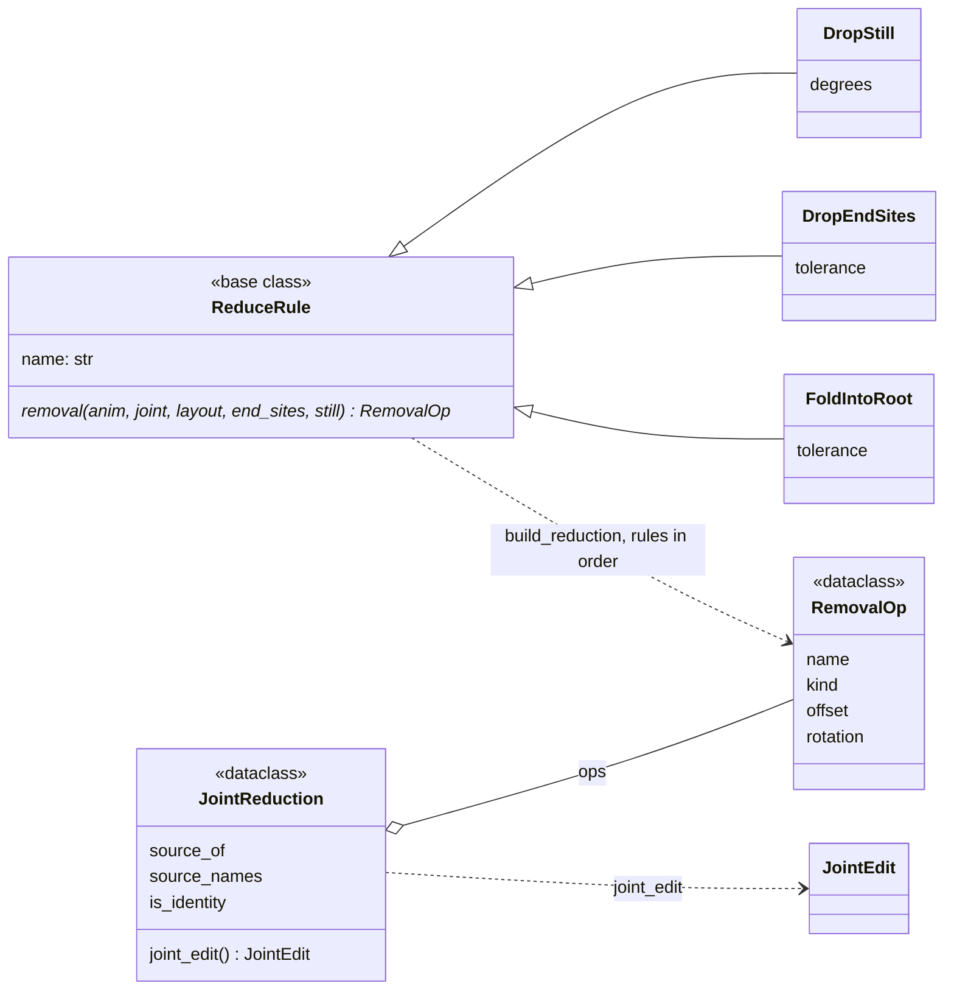

# features: reduction

Dropping joints that carry nothing learnable, and putting them back. The
reduction is applied at extraction time and never baked into the corpus: the
corpus keeps every joint the rig cleanup (`prune_unskinned`, a `prepare:` stage)
did not remove, because the prepared level stays a full-character artifact and a
generated clip must come back on the user's rig. Which
joints drop depends on the rotation layout
([Two rotation layouts](index.md#two-rotation-layouts)).

What may drop is the dataset config's `reduce:` list: rules from the `REDUCE`
registry (`drop_still`, `drop_end_sites`, `fold_into_root`), tried in that
order joint by joint, the first that applies removing the joint, the hierarchy
re-read after every removal. A rule of one's own is a `ReduceRule` subclass
with a `name`, imported through `custom_imports`. `skeleton.npz` records the
rules (`reduction_rules`) and every later reduction reads them back
(`load_rules`), so the read path cannot reduce by different rules than the
build did.

Besides the zero-length joints, which the geometry identifies, `drop_still`
drops **still joints**: a real joint whose local rotation turns less than its
`degrees` (0.5 in `configs/data/truebones.yaml`) over every frame of every prepared clip of its rig, with every joint below
it, unless that subtree holds a joint the manifest names (`foot_joints` and
the facing pairs: foot contact is measured on a toe's `*Nub` tip on many
Truebones rigs). `still_joints` measures them in stage 2's skeleton pass
(`src/poseydon/build/pipeline.py`), `skeleton.npz` records them with their
constant rotation (`reduction_still_names`, `reduction_still_rotations`), and
every later reduction reads that record (`load_still`): the stats pass,
`MotionDataset` and `RigRecord`. A removed joint comes back with the offset
and rotation its `RemovalOp` carries.

## Limitations

- **A joint with a rotation of its own is never removed, with two exceptions:
  still joints (above) and the root fold.** Otherwise only End Sites (leaves
  of the FULL rig) drop, so a real joint that becomes a leaf once its End Site
  goes stays (Bear's `NPC_*Arm2_ForearmTwist2`,
  Scorpion's `Bip01_Neck1`). The COLLAPSE fold is done only
  into the root: the folded joint comes back exact, but the root's own world
  rotation does not (`Hips` in 46 Truebones rigs, off by up to 141° on Eagle).
  The fold is wanted: some rigs carry an extra root joint (`Hips` above a
  coincident `Bip01_Pelvis`), and folding it gives every skeleton the same
  root. It is harmless only because the root drives no skin (`Hips` has zero
  weighted vertices on the 10 rigs checked); a dataset whose root is skinned
  would show it on the mesh, and nothing checks that.
- **A still joint is measured on the corpus, not read off the rig.** Adding
  or removing clips can change which joints are still, so `skeleton.npz` and
  `stats.npz` are rebuilt together (full `scripts/build_features.py`, not
  `--stats-only`). A generated clip cannot move a still joint, and a clip
  comes back with its still joints at the rig's constant rotation, off by up
  to the cut-off. The recipe records the `reduce:` rules (`data.reduce`), so a
  checkpoint sampled under other rules is refused; one trained before
  2026-10-19 recorded neither.
- **"End Site" is read off the hierarchy, not the file.** A leaf of the full
  rig is taken to have no rotation, which holds for BVH (a JOINT must have a
  child, an End Site has no channels). A source format that allows an animated
  leaf would need its channels consulted.

## Class diagram

`MotionDataset` builds one `JointReduction` per rig and checks it against the
`skeleton.npz` the build stored ([data](../data/index.md)); `RigRecord` undoes
it with `expand` ([export](../export/index.md)). `JointEdit` is in
[augment](../augment/index.md).

## Reference

::: poseydon.features.reduce
