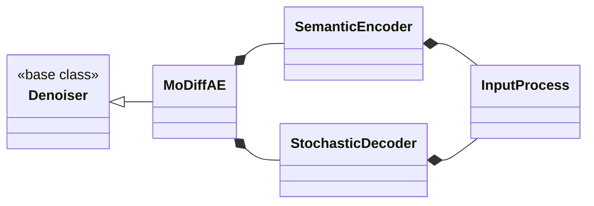

# API

One page per package, generated from the docstrings each time the site builds.
A package whose classes form a design (a base class with several
implementations, or a loop that owns or uses collaborators) opens with a class
diagram. Each box and line is read from the code: bases from the class
statement, ownership from what `__init__` constructs, the rest from what is
passed in and stored. A diagram shows only the members that explain the
design; the reference below it lists them all, one module at a time.

One page, one diagram. Where a package holds more than one design, each gets
its own page in the package's dropdown, with the modules it covers:
`build` has *preparation*, `features` has *reconstruction* and *reduction*.
Click a diagram to open it full-screen: the wheel zooms, dragging pans, and
Esc or a click outside closes it.

No diagram for `ingest` and `io`: their classes are standalone (a parse result,
a file format, a parameter record), with no hierarchy or collaborators to draw.

## How to read the diagrams

| line | meaning | read from |
|---|---|---|
| `A <|-- B` | B subclasses A | B's bases |
| `A <|.. B` | B satisfies Protocol A without inheriting it | method signatures |
| `A *-- B` | A owns B: it builds B itself (diamond at the owner) | A's `__init__`, or a field A fills itself |
| `A o-- B` | A holds B: B is made elsewhere and passed in | A's arguments or fields |
| `A --> B` | A uses B, which it does not own | a stored reference, or an argument of A's method |
| `A ..> B` | A creates or returns B in passing, without keeping it | A's method bodies |

| mark | meaning |
|---|---|
| `<<interface>>` | every method is abstract: a subclass supplies them all |
| `<<base class>>` | a base with working defaults; any abstract method is marked `*` |
| `<<Protocol>>` | a `typing.Protocol`: matched by shape, not by inheritance |
| `<<dataclass>>` | a `@dataclass` record |
| `method()*` | abstract: `@abstractmethod`, or raises `NotImplementedError` |

The label on a line says why it is there: `one per layer`, `optional`,
`per call`. `per call` marks something passed to a method rather than stored.

| colour | role |
|---|---|
| blue | interface, base class or Protocol |
| green | implemented on this page |
| amber | data class: a record or a config |
| grey, dashed | defined elsewhere (another package, or another page of this one), shown for context |

Each diagram repeats the colours it uses in a small legend underneath.

A diagram draws only what explains the design. `nn.Module`, as a base of every
model class, is left off.

### A worked example

`InputProcess` sits under two owners: the semantic encoder and the stochastic
decoder each build their own in `__init__`, so there are two instances with
separate weights, not one shared module. `MoDiffAE` is under two kinds of line
at once: `<|--` from `Denoiser`, because it subclasses that base, and the
`*--` diamonds to the encoder and decoder, because it owns them. The first
says what it can be used as; the second says what it is made of.
