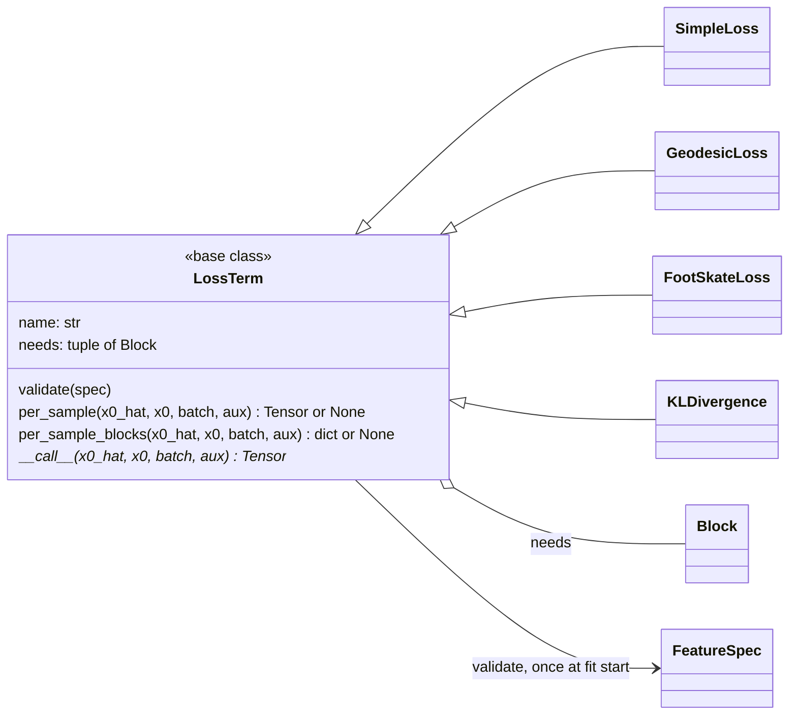

# losses

The terms of the training objective, each declaring the feature blocks it
needs and the space it needs them in (raw or normalized). The declaration is
checked against the active `FeatureSpec` once at fit start, so a term asking
for rotations a representation lacks fails at once. `MotionTask`
([training](../training/index.md)) weights and sums the terms, always on a
clean sample recovered through the process ([process](../process/index.md)).
Weights are set under `losses:` in `configs/train.yaml` (shipped:
`simple: 1.0, geodesic: 1.0`, the reference's paper command); foot skate is a
validation diagnostic, not a training term.

Structural terms (geodesic, foot skate) work in raw space: `raw_block`
denormalizes with the `norm_stats` conditioner's payload, because a
per-channel divide does not preserve rotations. Retarget metrics are not here
but in `src/poseydon/training/metrics.py`.

## Limitations

- **A new term must mask and denormalize itself.** Nothing checks that it uses
  `masked_mean` (padded frames and joints would otherwise count) or reads a
  structural block through `raw_block`. The shipped policy leaves
  `foot_contact` unscaled, so a normalized flag happens to still be 0/1; once
  `normalize:` scales it, thresholding the normalized flag silently drops every
  planted frame (`FootSkateLoss` docstring).

## Class diagram

A term always receives a clean sample (`x0_hat`), whatever the process
predicts: `MotionTask` maps the prediction back through `Process.to_z0` first
([training](../training/index.md)). `Block` and `FeatureSpec` are in
[core](../core/index.md).

## Reference

::: poseydon.losses
    options:
      members: false

::: poseydon.losses.base

::: poseydon.losses.footskate

::: poseydon.losses.geodesic

::: poseydon.losses.kl

::: poseydon.losses.simple
