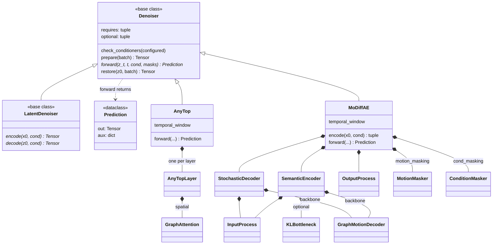

# models

The denoisers, AnyTop (feature space) and MoDiffAE (a diffusion autoencoder
with a per-frame semantic latent `z_sem`), with how each injects its
conditioning, the attention masks (padding, the temporal band) and the learned
null embeddings used when conditioning is hidden. Corruption and
parameterization are [process](../process/index.md)'s, the trajectory solver
[sampling](../sampling/index.md)'s, what conditioning is loaded
[conditioners](../conditioners/index.md)', and the loop
[training](../training/index.md)'s.

Both are ports of the reference: MoDiffAE keeps its module and parameter
names, so published checkpoints load without remapping. What changed is around
them: declared conditioning, named masks, and no blending inside `forward`.
MoDiffAE only accepts a `z_sem`; the controls that blend or pin it live in
[sampling.controls](../sampling/controls/index.md), and [ops](../ops/index.md)
drives `encode`. Selected by `configs/model/anytop.yaml` or
`configs/model/modiffae.yaml`; training runs `modiffae`, while
`configs/sample.yaml` defaults to `anytop` so the recipe check names the
`model=modiffae` override instead of loading the wrong architecture.

## Limitations

- **AnyTop ignores joint names unless `name_embedding_dim: 768` is set**
  (`configs/model/anytop.yaml`). Without it the projection is `None` and the
  `joint_names` payload is skipped without an error. MoDiffAE wires names
  itself and takes no such argument.

## Class diagram

Every class here is also an `nn.Module`, left off the diagram. `MoDiffAE`
subclasses `Denoiser`, not `LatentDenoiser`: it diffuses in feature space, and
its `encode` gives the semantic latent `Retarget` pins, not the space the
process corrupts. Nothing subclasses `LatentDenoiser` yet. The grey modules are
in [models.modules](modules/index.md).

## Reference

::: poseydon.models
    options:
      members: false

::: poseydon.models.anytop

::: poseydon.models.base

::: poseydon.models.modiffae
