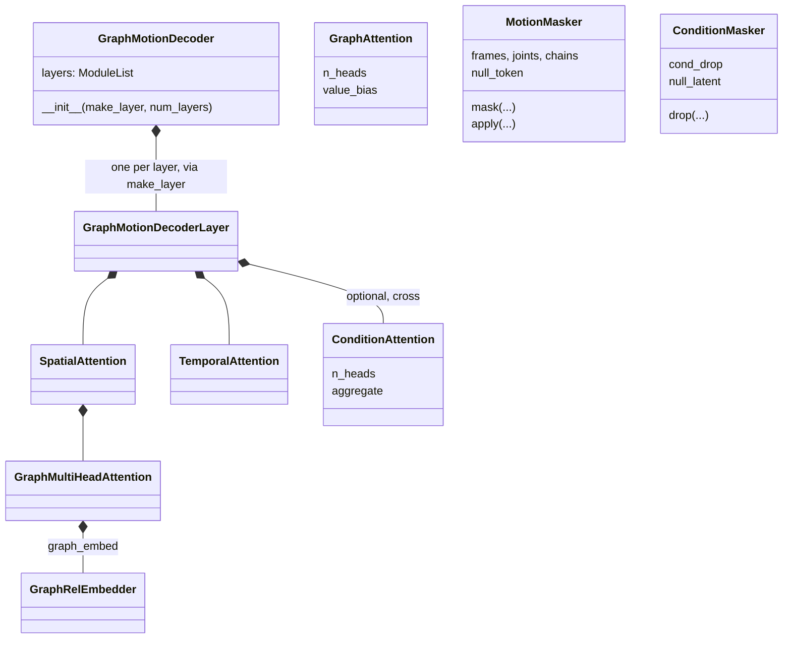

# models.modules

The building blocks of [models](../index.md): the graph backbone MoDiffAE's
encoder and decoder share (with `ConditionAttention`, multi-head semantic
modulation, averaged or summed), AnyTop's relation-biased `GraphAttention`,
positional and timestep embeddings, and the two maskers.

The maskers give the latent a bottleneck and guidance its unconditional branch.
Without masking, the semantic encoder sees the whole clip it is asked to
denoise and can carry a near-copy of it, which is fatal for retargeting.
`MotionMasker` hides frames, joints and whole kinematic chains (`chain_ids`)
from the encoder; `ConditionMasker` drops the whole latent for its learned
`null_latent`. Each null embedding exists only when its masking is on, so a
checkpoint trained with masking off has none to load, and guidance on it
raises.

## Class diagram

Three separate pieces: the graph backbone `MoDiffAE`'s encoder and decoder
are built on, `GraphAttention` (AnyTop's spatial attention, used by
`AnyTopLayer`), and the two maskers `MoDiffAE` owns
([models](../index.md)). All are `nn.Module`s.

## Reference

::: poseydon.models.modules
    options:
      members: false

::: poseydon.models.modules.embeddings

::: poseydon.models.modules.graph_attention

::: poseydon.models.modules.graph_backbone

::: poseydon.models.modules.masking
