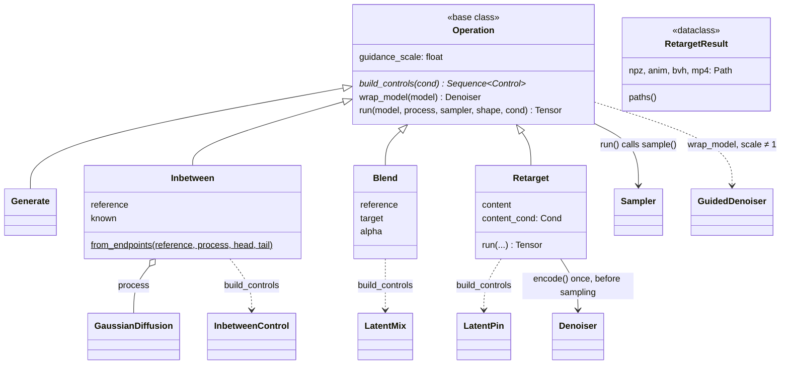

# ops

The verbs you run with a trained model: generate, in-between, blend and
retarget. An `Operation` builds the controls that express its task and runs a
sampler, so a new motion task is usually a control plus a thin operation, not a
new sampling loop. The samplers and controls are
[sampling](../sampling/index.md)'s, the network
[models](../models/index.md)', and writing a result onto a character
[export](../export/index.md)'s. Selected under `operation:` in
`configs/sample.yaml`.

`run_retarget` is the one retarget path, shared by `poseydon retarget` and the
training-time `RetargetValidation`, so what a run reports is what ships. A real
batch of the target rig supplies its conditioning ([data](../data/index.md));
the decode is as long as the content clip, because the latent is per-frame;
the reconstruction method comes from the recipe (`DEFAULT_RECONSTRUCT`), so
`sample`, `retarget` and validation agree. It writes `.npz` (positions and
latent), `.anim.npz` (the animation exactly as generated), `.bvh` and `.mp4`,
and returns a `RetargetResult` that `training/metrics.py` scores. The whole
flow is drawn on [Retargeting](../retargeting.md).

## Limitations

- **The target rig must keep its rest clip in the dataset.** `find_clip_of_rig`
  templates conditioning and geometry on the rest clip (`rest_action` in
  `skeleton.npz`), the rig's declared reference. A blacklist or split that
  leaves the rest clip out makes `sample` and `retarget` raise for that rig,
  although any clip of it would carry the same geometry.
- **`Blend` on a model without a semantic latent does nothing.** `LatentMix`
  writes `z_sem` into the conditioning, and AnyTop never reads it, so the
  result is plain generation with no error. `Retarget` checks for `encode` and
  raises instead.
- **`Blend` sizes its schedule from `reference.shape[0]`**, the batch axis of a
  `(B, T, C)` latent, while `LatentMix` counts frames on axis -2. Pass
  `length=` until it is fixed ([todo](../../index/todo.md)).
- **`inbetween` and `blend` have no CLI path.** `poseydon sample` instantiates
  `operation:` from the config, and both take tensors, so they run only from
  Python ([todo](../../index/todo.md)).

## Class diagram

`Operation` lives in `ops.base`; `Sampler`, the controls and `GuidedDenoiser`
in [sampling](../sampling/index.md); `Denoiser` in [models](../models/index.md).
`InbetweenControl` is `sampling.controls.inbetween.Inbetween`, imported under
that name. `RetargetResult` is what `run_retarget` returns; it holds no
operation, so it stands alone here.

## Reference

::: poseydon.ops
    options:
      members: false

::: poseydon.ops.base

::: poseydon.ops.blend

::: poseydon.ops.generate

::: poseydon.ops.inbetween

::: poseydon.ops.retarget

::: poseydon.ops.retarget_run
