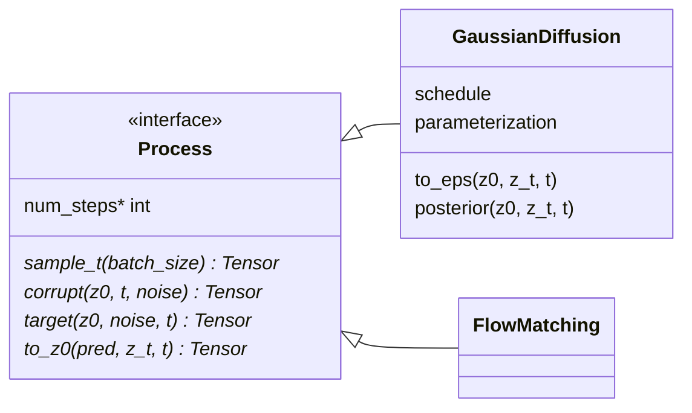

# process

Generative processes: how a clean sample is corrupted, what the network is
asked to predict, and how a clean sample is recovered from that prediction
(`to_z0`). A process knows nothing about motion, skeletons or features. It
does not own the network ([models](../models/index.md)), the reverse-time
solver ([sampling](../sampling/index.md)) or the loss terms
([losses](../losses/index.md)).

`MotionTask` uses it for noised samples and training targets
([training](../training/index.md)); samplers and the in-betweening control use
its per-step math. Selected by `configs/process/gaussian.yaml` (ships
`parameterization: x0`) or `configs/process/flow.yaml`:
`poseydon train process=flow` swaps diffusion for flow matching and nothing
else changes. Because every loss receives `to_z0`'s clean sample, whatever the
network predicts, the structural losses work under either process.

## Limitations

- **A new noise schedule must be accumulated in float64.** Nothing enforces
  it: a float32 cumulative product over 100 steps moved sampling by 2.5e-5
  relative against the reference, more than the model port's own error. See
  the comment in `src/poseydon/process/gaussian.py`.

## Class diagram

A process knows nothing about motion. `MotionTask` uses it to corrupt and
recover during training ([training](../training/index.md)); a `Sampler` uses
it to step back ([sampling](../sampling/index.md)).

## Reference

::: poseydon.process
    options:
      members: false

::: poseydon.process.base

::: poseydon.process.flow

::: poseydon.process.gaussian
