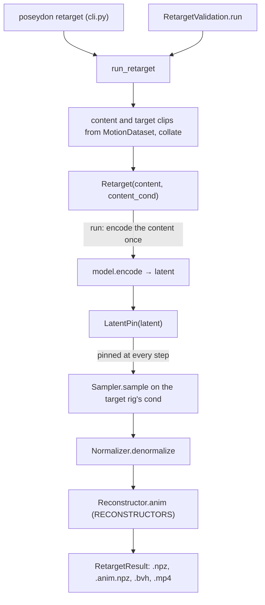

# Retargeting

Retargeting has no package of its own: it is a thin `Operation`, one
`Control`, and one end-to-end function, spread over [ops](ops/index.md),
[sampling.controls](sampling/controls/index.md),
[features: reconstruction](features/reconstruction.md) and [training](training/index.md). This page
draws how they meet; each class is documented once, on its package page.

| piece | role | reference |
|---|---|---|
| `run_retarget` | the one code path the CLI and training validation share | [run_retarget][poseydon.ops.retarget_run.run_retarget] |
| `Retarget` | encodes the content clip, then samples with its latent pinned | [Retarget][poseydon.ops.retarget.Retarget] |
| `LatentPin` | replaces the semantic latent in the conditioning before each step | [LatentPin][poseydon.sampling.controls.latent_pin.LatentPin] |
| `Reconstructor` | features back to an animation of the target rig | [Reconstructor][poseydon.features.reconstruct.Reconstructor] |
| `RetargetResult` | the written paths and the arrays `training/metrics.py` scores | [RetargetResult][poseydon.ops.retarget_run.RetargetResult] |
| `RetargetValidation` | runs it on fixed pairs during training | [RetargetValidation][poseydon.training.validation.RetargetValidation] |

With `guidance_scale` other than 1, `Retarget.run` samples a `GuidedDenoiser`
instead of the model itself ([Operation.wrap_model][poseydon.ops.base.Operation.wrap_model]).
