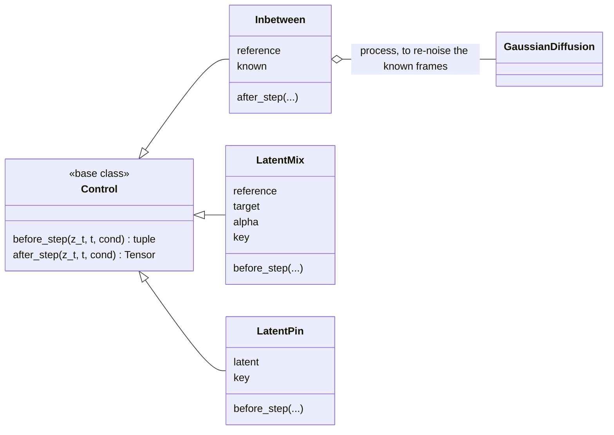

# sampling.controls

The step controls: `Inbetween` imputes known frames at every step, `LatentPin`
holds one semantic latent fixed for the whole trajectory (how retargeting
decodes one clip's content on another rig), and `LatentMix` blends two
latents on a schedule (`SCHEDULES` in
`src/poseydon/sampling/controls/latent_mix.py`). Each is built by the
operation of the same task ([ops](../../ops/index.md)) and run by a sampler
([sampling](../index.md)).

## Class diagram

`Control` is in [sampling](../index.md), `GaussianDiffusion` in
[process](../../process/index.md). Each control is built by the operation of
the same task ([ops](../../ops/index.md)).

## Reference

::: poseydon.sampling.controls
    options:
      members: false

::: poseydon.sampling.controls.inbetween

::: poseydon.sampling.controls.latent_mix

::: poseydon.sampling.controls.latent_pin
