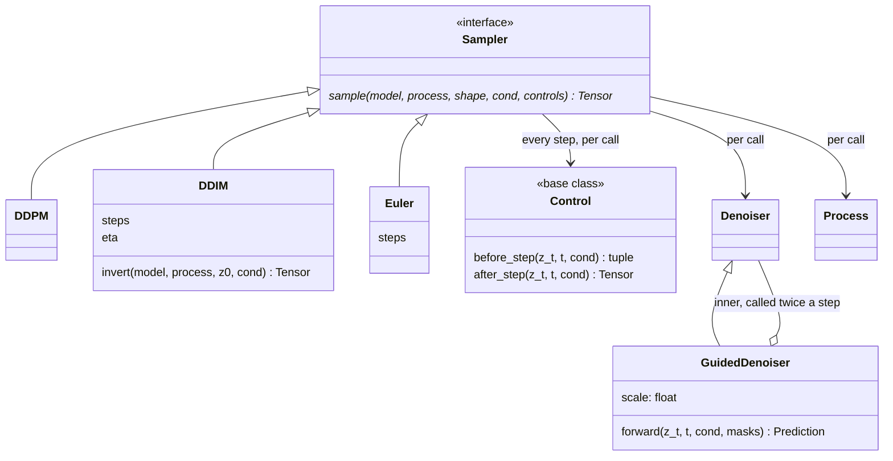

# sampling

How a reverse trajectory is solved (`Sampler`: `DDPM`, `DDIM`, `Euler`), what
is applied at each step (`Control`), and classifier-free guidance as a
denoiser wrapping a denoiser (`GuidedDenoiser`). It does not own the
user-facing verb ([ops](../ops/index.md)), the corruption math
([process](../process/index.md)) or the network ([models](../models/index.md)).

A sampler takes a `Denoiser`, a `Process` and the batch's `Cond`, and returns
generated features that [ops](../ops/index.md) hands to reconstruction
([features: reconstruction](../features/reconstruction.md)). Selected in
`configs/sample.yaml` under `sampler:` (default `DDIM`, 100 steps). Sampler,
control and operation are kept apart so a new task is a control plus a thin
operation, with no change to the model; the step controls are in
[sampling.controls](controls/index.md).

Guidance scale 1.0, the default, is the model as trained and costs one forward
pass; any other scale costs two per step (about 1.4x wall time for a retarget,
encode, IK and render included). Above 1.0 measured worse for retargeting at
25k steps; the measurements are in the comment above `guidance_scales:` in
`configs/train.yaml`.

## Limitations

- **`sampler:` does not reach retargeting.** `poseydon retarget` and the
  training-time validation both pass `DDPM()` (`src/poseydon/cli.py`,
  `build_validation` in `src/poseydon/training/build.py`), so changing
  `sampler:` in `configs/sample.yaml` changes `poseydon sample` only. The
  reason (no transition zone to anchor, so DDIM inversion buys nothing) is in
  the `src/poseydon/ops/retarget_run.py` docstring; `run_retarget` itself
  still takes any sampler.

## Class diagram

Guidance is a `Denoiser` wrapping a `Denoiser`, not a `Control`: a control
is never given the model, so it cannot run the second forward pass.
`Operation.wrap_model` builds the wrapper ([ops](../ops/index.md)). The
controls are in [sampling.controls](controls/index.md).

## Reference

::: poseydon.sampling
    options:
      members: false

::: poseydon.sampling.base

::: poseydon.sampling.diffusion

::: poseydon.sampling.flow

::: poseydon.sampling.guidance
