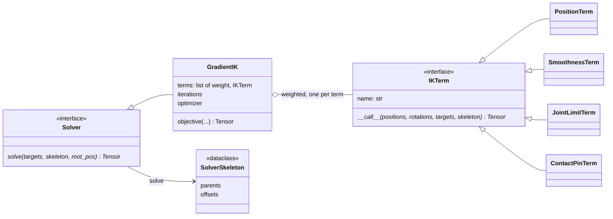

# solvers

Inverse kinematics: fitting joint rotations to desired positions, batched on
any device. It owns the seam (`Solver`, `IKTerm`), the gradient-descent solver
and its weighted terms. It does not decide when IK runs: that is
`SolvedPositions` (`positions_ik`) in
[features: reconstruction](../features/reconstruction.md). Forward kinematics
is `core.torch_kinematics` ([core](../core/index.md)).

The solve is parameterized in rotation space, so bone lengths are preserved by
construction and no term has to defend them; every frame is solved at once on
the tensors' device. Used by `poseydon sample reconstruct.name=positions_ik`,
retargeting and validation; tuned by `tools/ik_grid_search.py` and
`tools/ik_contact_compare.py`. The term weights in use come from that grid
search; the chosen values are **rationale not recorded** outside its output.
Recovery from features does not need IK at all, since the rotations are in
the representation (`src/poseydon/features/recover.py`): IK is for outputs
with positions but no consistent rotations.

## Limitations

- **IK cannot recover twist.** Rotation about a bone's own axis does not move
  its children, so the solve plateaus around 1% of a bone length on average
  (about 15% for the worst joint), not at zero. This is not a bug to chase;
  see the `src/poseydon/features/reconstruct.py` docstring.

## Class diagram

`SolvedPositions` ([features: reconstruction](../features/reconstruction.md)) builds a `GradientIK`
with a position and a smoothness term for each solve.

## Reference

::: poseydon.solvers
    options:
      members: false

::: poseydon.solvers.base

::: poseydon.solvers.gradient_ik

::: poseydon.solvers.terms
