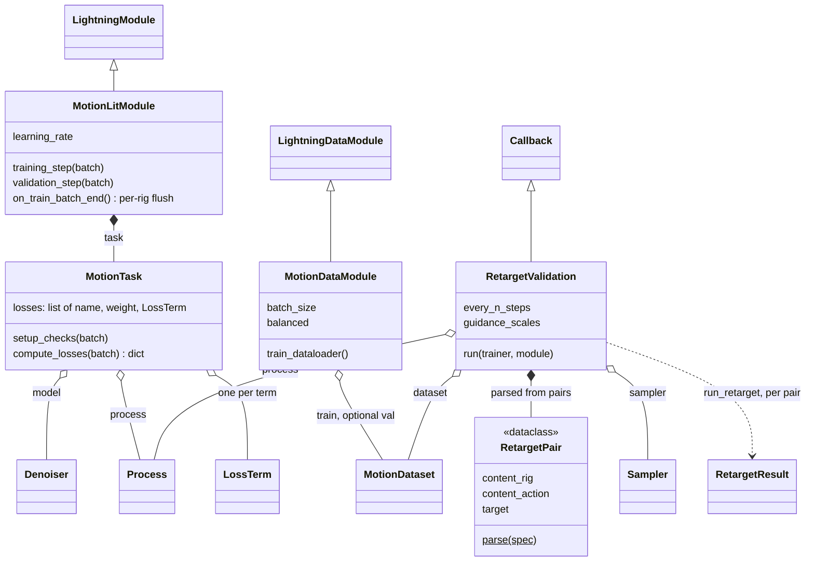

# training

From a composed config to a trained checkpoint: building the objects that
train (`training.build`), the one training task for every model × process ×
loss (`MotionTask`), the Lightning wrappers, the recipe recorded beside each
checkpoint, and retargeting watched during training with its metrics. It does
not own the model, process or losses themselves, the read path
([data](../data/index.md)), or the retarget run it calls
(`run_retarget`, [ops](../ops/index.md)).

It consumes almost every library package, `build` included (`CorpusIndex` for
the dataset, `RigTransform` for the metrics' prepared scale). Every component
is a registry name: a config entry names its class by `type:` (model, process,
window, augmentations, sampler, operation), and lists whose entries take no
arguments (features, conditioners, losses) by the bare name, so `poseydon list`
can enumerate them. A config's `custom_imports` are imported first, so a
registered class of one's own is named the same way. A run writes `runs/<run>/`: checkpoints, `recipe.yaml` and, when
validation is declared, retarget `.npz`/`.anim.npz`/`.bvh`/`.mp4` files logged
to wandb (or nothing, without `WANDB_API_KEY`). `poseydon sample`,
`poseydon retarget` and `run_retarget` read the recipe back, and
`check_recipe` fails when the active config disagrees on a `CHECKED` key, so
a mismatched `features` group (blocks and normalization) cannot sample the
right shapes with the wrong meaning. `data.paths.root` and `data.reduce` are
checked too: the rest-relative and bone-relative corpora share a schema and
differ in what each rotation means. A recipe written before 2026-10-19
records `features` as a bare list and is refused against this layout.

What a run logs, by wandb section (the key's first segment):

| section | keys | when |
|---|---|---|
| `loss` | `total`, `simple`, `geodesic`: batch means | every 50 steps |
| `loss_noise` | `<loss>/q1`..`q4`: split by the sample's noise quartile | every 50 steps |
| `loss_block` | `simple/<block>`: per feature block | every 50 steps |
| `loss_rig` | `<loss>/<Rig>`: averaged per rig since the last write | every 2500 steps (`RIG_LOG_EVERY`) |
| `optim` | `lr`, `grad_norm/<module>` and `/total` before clipping, `clipped` (1 when the clip fired) | every 50 steps |
| `weights` | `norm/<module>`, `update_ratio/<module>` (the step taken, relative to the weights) | every 50 steps |
| `retarget` | `<metric>/g<scale>`: mean over the validation pairs | every validation |
| `retarget_pair` | `<pair>/g<scale>/<metric>`: each pair | every validation |
| `retarget_video` | `<pair>/g<scale>`, `<pair>/source` | every validation |
| `val_loss`, `val_loss_noise`, `val_loss_block` | as their `loss` counterparts, on a validation split | only when the corpus has one |

`metric_name` maps `MotionTask.compute_losses` keys onto the `loss` sections.
The per-rig averages need each sample's rig: `MotionBatch.rigs`, filled by
`collate` from `Item.rig`; `compute_losses` returns the per-sample values
beside its scalars under `<loss>/per_sample`, which loggers skip.

Retargeting has no ground truth on the target rig, so the two validation
metrics with a right answer compare against the content clip itself:
`rec_error` decodes the content onto its own rig, `rec_cycle_error` decodes
the retarget back onto the content's rig (`reconstruction_metrics`, two more
decodes per pair and scale). Both are mean joint distances with the root's XZ
removed, in the content rig's mean bone length. They replace the latent round
trip, which re-encoded the output on the target rig against a latent taken on
the content rig, and stayed near 21 while the renders improved.
Bone-length drift is measured on the prediction before the IK solve, where
it reports the model rather than the solver. Guidance scales other than 1.0
need a model trained with `model.cond_drop > 0`; with the default 0.0,
`build_validation` keeps only 1.0 and warns.

## Limitations

- **Per-rig averages are not resumed.** The sums since the last flush live
  on the module, not in the checkpoint, so a resume drops up to
  `RIG_LOG_EVERY` steps of them and the first average after it covers fewer
  samples.
- **Adding a key to `CHECKED` does not protect older checkpoints.**
  `check_recipe` ignores a key the recorded recipe lacks, so recipes written
  before the key existed pass unchecked. One level deep only: a key added
  inside an already-checked block (`model.masking.<leaf>`) makes old recipes
  fail the check instead. See the comment above `CHECKED` in
  `src/poseydon/training/recipe.py`.

## Class diagram

`LightningModule`, `LightningDataModule` and `Callback` are Lightning's.
`training.build` assembles all of these from the Hydra config; the
`RetargetValidation` run goes through the same `run_retarget` as the
`poseydon retarget` command ([Retargeting](../retargeting.md)).

## Reference

::: poseydon.training
    options:
      members: false

::: poseydon.training.build

::: poseydon.training.lightning

::: poseydon.training.metrics

::: poseydon.training.recipe

::: poseydon.training.task

::: poseydon.training.validation
