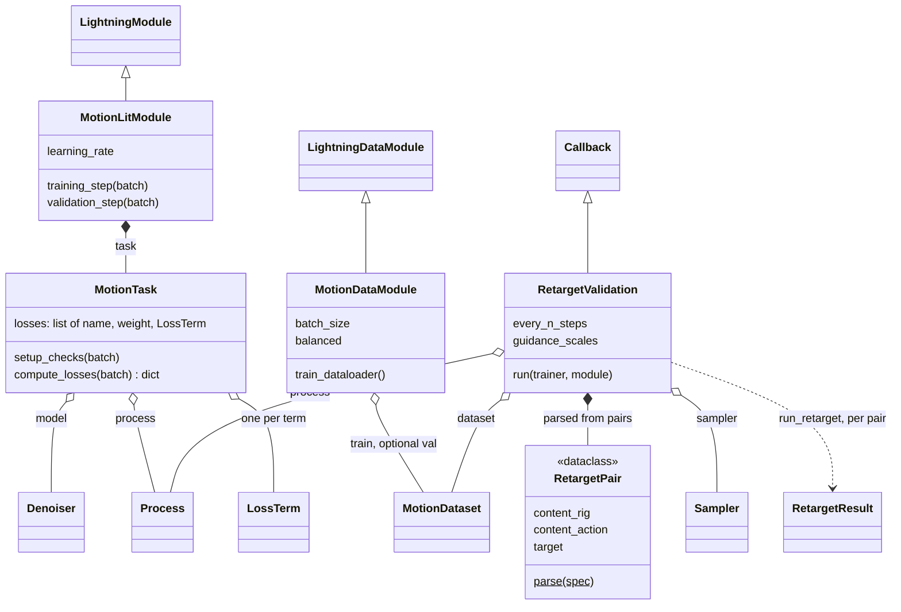

# training

From a composed config to a trained checkpoint: building the objects that
train (`training.build`), the one training task for every model × process ×
loss (`MotionTask`), the Lightning wrappers, the recipe recorded beside each
checkpoint, and retargeting watched during training with its metrics. It does
not own the model, process or losses themselves, the read path
([data](../data/index.md)), or the retarget run it calls
(`run_retarget`, [ops](../ops/index.md)).

It consumes almost every library package, `build` included (`CorpusIndex` for
the dataset, `RigTransform` for the metrics' prepared scale). Singular choices
(model, process, window) are Hydra groups with `_target_`; lists (features,
conditioners, losses) are registry names, so `poseydon list` can enumerate
them. A run writes `runs/<run>/`: checkpoints, `recipe.yaml` and, when
validation is declared, retarget `.npz`/`.anim.npz`/`.bvh`/`.mp4` files logged
to wandb (or nothing, without `WANDB_API_KEY`). `poseydon sample`,
`poseydon retarget` and `run_retarget` read the recipe back, and
`check_recipe` fails when the active config disagrees on a `CHECKED` key, so
a mismatched `features:` cannot sample the right shapes with the wrong
meaning.

Bone-length drift is measured on the prediction before the IK solve, where
it reports the model rather than the solver. Guidance scales other than 1.0
need a model trained with `model.cond_drop > 0`; with the default 0.0,
`build_validation` keeps only 1.0 and warns.

## Limitations

- **Adding a key to `CHECKED` does not protect older checkpoints.**
  `check_recipe` ignores a key the recorded recipe lacks, so recipes written
  before the key existed pass unchecked. One level deep only: a key added
  inside an already-checked block (`model.masking.<leaf>`) makes old recipes
  fail the check instead. See the comment above `CHECKED` in
  `src/poseydon/training/recipe.py`.

## Class diagram

`LightningModule`, `LightningDataModule` and `Callback` are Lightning's.
`training.build` assembles all of these from the Hydra config; the
`RetargetValidation` run goes through the same `run_retarget` as the
`poseydon retarget` command ([Retargeting](../retargeting.md)).

## Reference

::: poseydon.training
    options:
      members: false

::: poseydon.training.build

::: poseydon.training.lightning

::: poseydon.training.metrics

::: poseydon.training.recipe

::: poseydon.training.task

::: poseydon.training.validation
