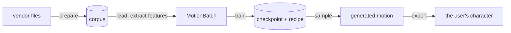

# Design rationale

A whole family of motion papers builds on
[MDM](https://guytevet.github.io/mdm-page/), the Motion Diffusion Model, and
on its code. That code did its job in 2022. Let's be honest about it by
today's standards, though: there is no modularity to speak of, every new idea
is another flag threaded through the same files, and extending or maintaining
it is a chore. Ask anyone who has tried.

PoseYdon is the answer to that frustration. Its starting point is
[Neural Motion Blending](https://mmlab-cv.github.io/neural_motion_blending/),
an earlier work by this repository's author.

This page walks through the handful of rules that keep it modular. The per-package *Why it is shaped this way*
sections in the [index](../../index/INDEX.md) go deeper and cite the code
and commits behind each decision.

## The big picture

Motion flows through three phases, and each phase hands the next a well-defined
object:



1. **Prepare** turns vendor files into a consistent corpus, recording how to
   undo every step.
2. **Train** reads windows of motion, turns them into features, and trains a
   model to generate them.
3. **Sample and export** generate new motion and put it back on a real
   character.

The code is split into a **library** (`src/poseydon/`), which owns every
contract, and **tooling** around it (scripts, configs, tests) which only uses
the library. A change to the library can break any caller; a change to a
script breaks only whoever runs it.

## Skeleton knowledge is data, not code

Each character is described by a YAML manifest that names its joints: which
are the feet, which pairs tell its facing, which clip holds its rest pose.
Adding a character means adding files, not code, and a manifest can inherit
from a shared base so settings common to a dataset are written once.

Joints are referenced by name, never by index. A wrong or missing name fails
loudly and suggests the closest match, where an index into a re-exported rig
would silently point at the wrong joint and mirror the character.

```yaml
skeleton: Flamingo
facing:
  hips:      {right: Bip01_R_Thigh,   left: Bip01_L_Thigh}
  shoulders: {right: BN_Forearm_R_02, left: BN_Forearm_L_02}
foot_joints: [Bip01_R_Foot, Bip01_R_Toe0, ...]
tags: [biped, bird]
```

## Features are computed when data is read

The corpus stores the prepared animation, not features. Features are computed
as each training window is read, from a list of named blocks, so changing the
representation never means rebuilding the dataset:

```yaml
features: [ric_pos, rot6d_joint, heading, local_vel, foot_contact]   # 15 channels per joint
features: [ric_pos, rot6d_bone, local_vel, foot_contact]             # 13, the reference's layout, same files
```

A [`FeatureSpec`][poseydon.core.spec.FeatureSpec] records which block sits where, so code asks for a block by
name. A loss that needs rotations asks for `rot6d_joint` and gets an error on a
representation without one, instead of reading whatever happens to sit at
`[..., 3:9]`:

```python
spec.take(features, "rot6d_joint")          # (F, J, 6)
spec.take(batch.x, "rot6d_joint", axis=2)   # (B, J, 6, T): channels are not last here
```

The axis is passed explicitly because it really does differ between a clip and
a batch (see [Notation](data/notation.md#array-shapes)); a helper that
guessed would read frames as channels.

## Only declared conditioning is loaded

A [`MotionBatch`][poseydon.core.batch.MotionBatch] carries only four things: the motion tensor, its
`FeatureSpec`, masks saying which frames and joints are padding, and where the
window came from. Every other input is a **conditioner** the config declares:

```yaml
conditioners: [topology, tpose, norm_stats, joint_names]   # skeleton-aware model
conditioners: []                                           # unconditional
```

A model states which conditioners it needs, so a mismatch fails in the first
second of a run. The list is also written into the checkpoint's recipe and
checked again when sampling, because a model sampled without an input it was
trained with doesn't crash: it produces plausible-looking garbage.

## Latent models are subclasses

[`Denoiser`][poseydon.models.Denoiser] works on features. [`LatentDenoiser`][poseydon.models.LatentDenoiser] is a subclass that overrides
`prepare` and `restore` with its own encoder and decoder. The training code is
the same for both and never asks which kind of model it has.

## Sampler, control and operation are three separate things

Generating motion is split three ways:

| piece | job | examples |
|---|---|---|
| **sampler** | walks from noise to motion | [`DDPM`][poseydon.sampling.DDPM], [`DDIM`][poseydon.sampling.DDIM], [`Euler`][poseydon.sampling.Euler] |
| **control** | edits each step along the way | guidance, imputation (fixing known frames), latent pinning |
| **operation** | the thing a user asks for | `generate`, `inbetween`, `blend`, `retarget` |

In-betweening then needs no model change: it is `generate` with an imputation
control that keeps the given frames fixed. Retargeting is a control too,
pinning one clip's latent while decoding onto another rig. (In the reference,
blending lived inside the model's forward pass, which is why in-betweening
was unreachable there.)

## Every transform can be undone, and records how

The model sees every character in one shared frame, without the joints it
can't learn from; the user gets the output back on *their* character, with its
own joints, units and mesh. That works because every step that changes a
character saves what undoing it needs: preparation in `preproc.npz`, joint removal in `skeleton.npz`, training
settings in the recipe. Export replays them in reverse. Preparation (which
moves things) and reduction (which removes joints) are kept apart so that each
can be undone exactly on its own. [The round trip](data/roundtrip.md) is the
full story.

## Matching the reference is measured, not claimed

Where PoseYdon matches the reference, a measurement says so: features agree
to about 1e-6, and DDPM/DDIM sampling to about 1e-6 relative. Where it
deliberately differs, the code comment or commit message records the
measurement behind the choice. The reference itself runs in the `compat`
container, driven by `tools/reference/`.

The same habit applies to tests: a test only counts once it has been seen to
fail when the thing it checks is broken. See [Testing](../how-to/testing.md).
