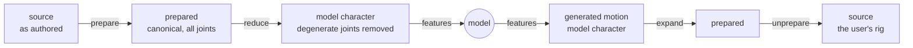

# Data round trip: from the user's rig and back onto it

A character goes in as the vendor or user authored it. It comes back out, after
the model has generated or retargeted motion for it, **on that same
character**: the same joint names, hierarchy, units, channel layout, bind pose
and, for FBX, mesh. Everything between the two ends is allowed to be canonical
and reduced, because every step that changes the character records how to
undo itself.

That promise is why preparation is a chain of invertible stages rather than a
preprocessing script, and why the corpus keeps every joint even though the
model sees fewer. Without it, PoseYdon would be a benchmark rather than a tool
anyone can hand a rig to.



## Three levels

| level | joints | geometry | lives in |
|---|---|---|---|
| **source** | as authored | as authored | `data/_raw/truebones/<Rig>/` |
| **prepared** | same as source | bind removed, root promoted, faced +Z, rigid, centred, scaled, grounded | `data/truebones/clips/<Rig>/` |
| **model** | zero-length bones removed | as prepared | features, `skeleton.npz` |

Preparation changes geometry and keeps structure. Reduction changes structure
and keeps geometry. Keeping them separate is what makes each one exactly
invertible on its own.

## Going in: preparation

`prepare_chain()` in `src/poseydon/build/prepare.py` is the single definition
of the stage order, used both for preparing and for undoing. Each stage
implements `fit`, `apply` and `invert`, and what it fitted is saved to
`rigs/<Rig>/preproc.npz`. Inversion reads those saved parameters and never
refits.

| # | stage | scope | what it does | what undoing it needs |
|---|---|---|---|---|
| 1 | `RestRelative` | rig | removes the per-joint bind rotation Biped exporters bake into every clip, so identity means the rest pose | the rest pose's bind rotations |
| 2 | `PromoteRoot` | rig | moves the root off a ground locator onto the first body joint (14 of 73 Truebones rigs) | the removed chain above the new root |
| 3 | `FaceAxis` | **clip** | turns the clip so its frame-0 facing points along +Z | that clip's yaw, which can't be recovered from the prepared file |
| 4 | `EnforceRigid` | rig | drops non-root translation so bone lengths are constant | the source's channel declaration, which the writer restores |
| 5 | `CentreXZ` | rig | puts the root at the XZ origin on the rest pose's first frame | the offset |
| 6 | `ScaleToMeanBoneLength` | rig | scales so the mean bone length matches the reference's SMPL mean | the scale factor |
| 7 | `PutOnGround` | rig | puts the rest pose's lowest joint at y = 0 | the offset |

**Rig scope versus clip scope** decides what survives. Rig stages fit once on
the rest pose and are shared by every clip of the character. Fitting
grounding per clip would put a flying creature on the floor and erase the
height difference between a crouch and a stand. `FaceAxis` is the only clip
stage, so it is the only parameter recorded per clip.

You run preparation with `scripts/process_dataset_truebones.py` (BVH) and
`scripts/process_dataset_truebones_fbx.py` (FBX). Each rig also gets a
`report.json` recording what was done and why. See [build](../index/library/build.md).

## The model's view: reduction

A zero-length bone moves nothing. Truebones rigs carry ten or more per
character: every End Site, plus the odd dummy. `src/poseydon/features/reduce.py`
handles them in two ways:

- a zero-offset **leaf** is deleted outright, losing nothing;
- a zero-offset **internal** joint is folded into its parent only when it is
  that parent's only child. Otherwise folding would turn its siblings, so the
  joint is kept.

Reduction is applied **when features are read, never written into the
corpus**. Skin weights are indexed by the original joint order, so the corpus
has to keep every joint for a generated clip to land back on the rig. The
recorded `JointReduction` is replayed in reverse by `invert_reduction`. See
[features](../index/library/features.md).

## Coming back: export

`CharacterExporter` in `src/poseydon/export/character.py` takes a model-space
animation and writes one of three representations:

| representation | joints | frame | written onto |
|---|---|---|---|
| **prepared** | exactly the model's | canonical (+Z, scaled, centred, grounded) | a bare skeleton (BVH) or `char-model.fbx` |
| **presentation** | the full deformation rig | see [export](../index/library/export.md) | `char-full.fbx` |
| **original** | the source's own, after expansion | source units, frame, names, channels and bind | the raw vendor FBX, or a BVH with the source's `CHANNELS` block |

Presentation exists only as FBX, because a BVH carries no mesh. Only the
original representation expands the reduction and inverts preparation. A prepared export is the model character exactly as the model
sees it.

`poseydon export` takes a generated clip as `.bvh` or `.npz`. BVH output runs
anywhere; FBX output needs the `fbx` container.

```bash
# BVH needs no Blender, so the test container works
poseydon export samples/Scorpion__clip.bvh --rig Scorpion \
    --representation original --format bvh --out scorpion.bvh

# inside the fbx container: FBX goes through Blender
docker compose run --rm fbx blender -b --python scripts/anim_2_fbx.py -- \
    runs/<run>/retargets/step-75000/Flamingo_onelegbent__to__Scorpion.npz \
    --skin --out out/scorpion.fbx
```

**Facing.** A generated clip never had a facing of its own. With no
`--facing-from`, the exporter restores the **rig's** facing, the one recorded
for the rest pose. With `--facing-from <action>`, it restores that recorded
clip's yaw instead. If the rig's facing was never recorded, export raises an
error rather than substituting an identity rotation. That identity fallback
was removed because it moved reinserted roots by 22–167% of the rig's extent.

**Refusals.** Export fails loudly, never silently, when the generated topology
doesn't match `skeleton.npz`, when an asset or transform is missing, when a
removed joint still carries skin weights, or when the bind fit is off. A
BVH-only rig asked for FBX reports `source_surface_missing`. Check a rig's
`report.json` before requesting a representation.

## What it loses on purpose

The round trip is exact wherever the contract allows, and lossy in a few
places by design. All numbers below come from the 2026-09-28 audit.

- **Per-joint translation** that the source animated is dropped by
  `EnforceRigid`. That is real motion, roughly 10% of skeleton size on raw
  Truebones, and it is the price of a rigid skeleton.
- **One rigid geometry per rig.** Per-clip bone vectors are replaced by the
  rest clip's. On some attack clips joints come back up to 15% (Dog) and 25%
  (Horse) of the extent away from the raw source. About 2.9% of rigid
  joint-clips come back with a different constant bone vector, mostly props
  and locators.
- **Removed locators above the root** come back at a constant pose.
- **Twist on a reduced joint is gone.** For example, Bear's zero-offset but
  skinned forearm-twist bones leave the forearm skin up to 5.5% of the mesh
  extent off.

## How it's verified

| check | what it proves |
|---|---|
| `tests/build/test_roundtrip.py` | source → prepare → reduce → expand → unprepare returns the source rig, also with features in the middle |
| `tests/export/test_export_fidelity.py` | the default facing is a rigid frame; restoring a real clip returns its body pose; original BVH keeps the source `CHANNELS` block across a write/read cycle; a missing stage parameter is named, not skipped |
| `tests/export/test_export_fidelity_fbx.py` | FBX exports stay rigid, keep the clip's own frame 0, track every frame, and refuse a mismatched rig as a typed absence (Blender suite) |
| `tests/build/test_roundtrip_fbx.py` | the FBX read/write layer preserves skeletons and posed animation (Blender suite) |
| `tests/build/test_bvh_fbx_agreement.py`, `scripts/check_fbx_coherence.py` | the BVH and FBX arms describe the same motion, compared in world space |
| `scripts/build_skeleton_visual_debug.py` + `_fbx.py` | one bundle per rig with source, prepared, model and round-tripped versions of the **same** clip, to open side by side in Blender |

When checking a round trip by hand, compare against an **independent**
reference: Blender's stock BVH importer, the vendor's own per-action FBX, or
the raw file text. A reference built from the pipeline's own formulas or
manifest facing pairs agrees with the pipeline by construction and proves
nothing.

## Open issues

As of 2026-10-12, these are not fixed in committed code. Update this section
when they land.

- Stages after `PromoteRoot` receive pre-promotion joint indices, so facing on
  promoted rigs is computed from the wrong joints.
- The BVH writer writes MOTION columns in joint-index order rather than the
  hierarchy's depth-first order, and ignores a declared channel interleave.
- `poseydon sample` and retargeting borrow the target rig's conditioning from
  its first-indexed clip, not its rest clip. Because `FaceAxis` rotates
  offsets per clip, exporting with the rig's facing can then come back
  rotated or distorted.
- FBX export drops held leading and trailing frames from its keys. The take
  span stays correct.

Fixes for the first two exist as uncommitted work.

## Where to read further

- [build](../index/library/build.md): the stages, `RigTransform`,
  `preproc.npz`
- [features](../index/library/features.md): reduction and expansion
- [export](../index/library/export.md): `CharacterExporter`
- [io](../index/library/io.md): what BVH and FBX can and can't carry
- design: data pipeline spec §1, §3 and §6
  (`docs/superpowers/specs/2026-09-06-data-pipeline-and-training-parity-design.md`)
  and the character export spec
  (`docs/superpowers/specs/2026-09-19-character-aware-motion-export-design.md`)
