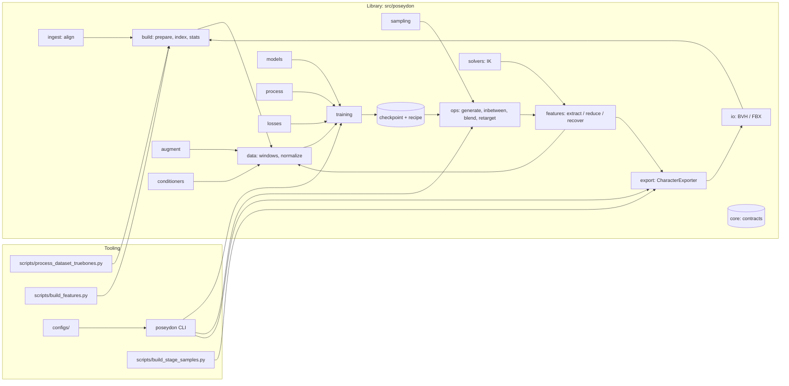

# Overview

PoseYdon is research infrastructure for neural motion: generation, editing,
in-betweening and cross-topology retargeting on one representation, one
training loop and one set of contracts. It rebuilds the scaffolding of the
MDM lineage so that the process, the feature set, the model and the loss are
separate objects a config composes, not flags bolted onto a monolith.

## The pipeline

Motion moves through three levels: **source** (as the vendor authored it),
**prepared** (same joints; bind removed, faced +Z, rigid, scaled, grounded,
centred) and **reduced** (degenerate joints removed, as features). Preparation
changes geometry and keeps structure; reduction changes structure and keeps
geometry. Both are invertible, which is what lets a generated clip go back onto
the character the user supplied. The [round-trip guide](../guides/roundtrip.md)
walks through it end to end.

Every library package imports [`core`](library/core.md); that edge is left out
of the diagram. Raw vendor data comes in under `data/_raw/` and prepared data
goes out to `data/truebones/`. See [tooling](tooling.md) for that side.

### Stage 1: prepare (source → prepared)

[`build`](library/build.md) runs an invertible chain of geometry stages over
each raw clip, read and written through [`io`](library/io.md) and aligned by
[`ingest`](library/ingest.md). It writes `preproc.npz` (the parameters and their
inverse), the prepared clips and a `report.json` per rig. You drive it with
`scripts/process_dataset_truebones.py`; preparation runs on the BVH only, and FBX
enters at export. `poseydon ingest` is a separate, legacy entry point whose
aligned output nothing reads; see [`ingest`](library/ingest.md).

### Stage 2: build (prepared → model-ready corpus)

`scripts/build_features.py` runs [`build`](library/build.md)'s four passes:
clip, skeleton, stats and index. Only `stats.npz` depends on the feature
schema, so changing `features:` re-runs one pass instead of rebuilding the corpus.

### Read path and training

[`data`](library/data.md) reads the index, crops windows, applies
[`augment`](library/augment.md), extracts [`features`](library/features.md) at read
time, normalizes them and collates them into a `MotionBatch` that carries only
the declared [`conditioners`](library/conditioners.md).
[`training`](library/training.md) builds the model, process and losses from the
composed config, trains one task, and writes a recipe beside the checkpoint.
The recipe is checked again at sampling time.

### Sampling, retargeting and export

[`ops`](library/ops.md) holds the user-facing verbs. Each one drives a
[`sampling`](library/sampling.md) sampler, plus step-level controls, over a
[`models`](library/models.md) denoiser and a [`process`](library/process.md).
[`features`](library/features.md) turns the generated features back into a
skeleton, optionally refitting positions with [`solvers`](library/solvers.md) IK.
[`export`](library/export.md) expands the reduced joints, undoes preparation and
writes the prepared or original representation as BVH or FBX.

## Rules that cut across packages

### Skeleton knowledge is data

A dataset is a folder of motion files plus one YAML manifest per skeleton.
Joints are referenced by name, never by index, so a re-exported rig fails loudly
instead of silently mirroring the character. Adding a character means adding
files. Worked example:
[architecture guide](../guides/architecture.md#skeleton-knowledge-is-data).

### Features are composed at read time

Disk stores the canonical prepared animation, not features. A `FeatureSpec`
owns the layout, so code asks for a block by name and fails loudly against a
representation that lacks it. Changing the representation never re-runs
preparation. Worked example:
[architecture guide](../guides/architecture.md#features-are-composed-at-read-time).

### Only declared conditioning is loaded

`MotionBatch` carries the tensor, its spec, its masks and its provenance.
Anything else is a declared conditioner. The conditioner list is recorded in
the recipe and checked at sampling time, because sampling without a conditioner
the model trained with produces plausible-looking garbage and no error. Worked
example: [architecture guide](../guides/architecture.md#only-declared-conditioning-is-loaded).

### Latent models subclass; they do not get an injected autoencoder

`LatentDenoiser` overrides `prepare`/`restore` with its own encoder and
decoder. The task body is the same for every model, and nothing branches on
model kind. Worked example:
[architecture guide](../guides/architecture.md#latent-models-subclass-they-do-not-get-an-injected-autoencoder).

### Sampler, control and operation are separate

A sampler solves the trajectory, a control edits each step, and an operation is
the user-facing verb. In-betweening is imputation during sampling and needs no
model change. Worked example:
[architecture guide](../guides/architecture.md#sampling-separates-three-things-the-reference-conflates).

### Every transform is invertible and recorded

Preparation and reduction both record their inverse: `preproc.npz`, the
reduction mapping in `skeleton.npz`, and the recipe beside each checkpoint.
That record is what lets [`export`](library/export.md) carry a generated clip
back to the user's original rig (see the
[round-trip guide](../guides/roundtrip.md)).

### Parity is measured, not claimed

Where PoseYdon matches the reference implementation, it is measured: features
to ~1e-6, and DDPM/DDIM sampling to ~1e-6 relative. Where it deliberately
differs, the code comments and commit messages record the measurement
behind the choice. The reference runs
in the `compat` container, and `tools/reference/` drives it.
