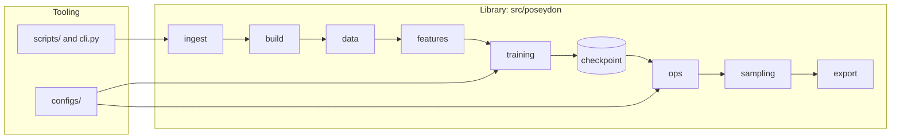

# Documentation Index Implementation Plan

> **For agentic workers:** REQUIRED SUB-SKILL: Use superpowers:subagent-driven-development (recommended) or superpowers:executing-plans to implement this plan task-by-task. Steps use checkbox (`- [ ]`) syntax for tracking.

**Goal:** Build `docs/index/`, an agent-first map of the repo plus per-package design pages, served as a MkDocs Material site and kept structurally honest by a test.

**Architecture:** Plain markdown under `docs/index/`, split into *library* (`src/poseydon/`, one page per subpackage under `library/`) and *tooling* (everything around it, one page). `tests/test_docs_index.py` checks that the index names every package, script and tool, names nothing that no longer exists, and that every package page exists with fixed headings. `CLAUDE.md` carries the prose upkeep rule. `mkdocs.yml` renders all of `docs/` with no explicit nav, so new specs and plans appear without config changes.

**Tech Stack:** Markdown, Mermaid, MkDocs 1.6 + Material (via `uvx`, not installed), pytest (stdlib-only test).

**Spec:** `docs/superpowers/specs/2026-10-12-docs-index-design.md`

## Global Constraints

- Library = `src/poseydon/`; tooling = `scripts/`, `tools/`, `configs/`, `tests/`, `data/` layout, `docs/`, docker services. Every page keeps the two visibly apart.
- `INDEX.md` has exactly two top-level parts: `## Library` and `## Tooling`.
- Package pages live at `docs/index/library/<pkg>.md` and carry these five `##` headings, in this order, verbatim: `Purpose`, `Key files and types`, `How it connects`, `Why it is shaped this way`, `Gotchas`.
- Reference code as inline code paths (`src/poseydon/core/spec.py`), never as markdown links. Links leaving `docs/` break `mkdocs build --strict`.
- Never invent rationale. If no "why" is recorded in code, docstrings, specs or `git log`, write **rationale not recorded**.
- No API reference, and no copying of `guides/architecture.md`. Link to it instead.
- No new `pyproject.toml` dependency. The site runs with `uvx --with mkdocs-material mkdocs serve`.
- Tests run only in docker: `docker compose run --rm -T test python -m pytest <path> -q`. Nothing runs on host Python.
- Commit only the files the task names. The working tree carries unrelated uncommitted work, so always use `git commit -- <paths>`, never `git add -A`.
- Commit messages end with:
  ```
  Co-Authored-By: Claude Opus 5.5 <noreply@anthropic.com>
  Claude-Session: https://claude.ai/code/session_01LcLuk3mMD9WxCvGH3TWWKF
  ```

## Review Focus

1. Placeholders in INDEX.md (`data/truebones/rigs/<Rig>/manifest.yaml`, `*.npz`) must not be reported as missing paths. Pinned by `test_mentioned_paths_skips_patterns_commands_and_urls` (Task 1).
2. `core/spec.py:42`, `src/poseydon/core/` and `docs/index/library/core.md#purpose` must all resolve to the bare path. Pinned by `test_mentioned_paths_normalises_suffixes` (Task 1).
3. A non-package directory (`__pycache__`, `tools/reference` data dir) or `__init__.py` must not be demanded in the index. Pinned by `test_required_paths_ignores_non_packages` (Task 1).
4. A newly added subpackage without an index row or page must fail the suite. Pinned by the manual mutation step in Tasks 1 and 6.
5. A page with a heading misspelled or out of order must fail. Pinned by `test_missing_sections_reports_absent_and_misordered` (Task 6).

---

### Task 1: Index checker and INDEX.md

**Files:**
- Create: `tests/test_docs_index.py`
- Create: `docs/index/INDEX.md`

**Interfaces:**
- Produces: `mentioned_paths(text: str) -> set[str]`, `required_paths(root: Path) -> set[str]`, `ROOT: Path`, `INDEX: Path` in `tests/test_docs_index.py`. Task 6 adds to this file.

- [ ] **Step 1: Write the test file**

```python
"""docs/index/ must track the tree it describes.

Only structure is checked: that INDEX.md names every package, script and tool,
and names no path that has gone. Whether the prose is still true cannot be
tested; that is the upkeep rule in CLAUDE.md.
"""

from __future__ import annotations

import re
from pathlib import Path

ROOT = Path(__file__).resolve().parents[1]
INDEX = ROOT / "docs" / "index" / "INDEX.md"

_CODE = re.compile(r"`([^`\n]+)`")


def mentioned_paths(text: str) -> set[str]:
    """Repo paths named in inline code, without trailing slash, :line or #anchor.

    A span counts as a path only if it contains "/". Spans with spaces are
    commands, spans with <, *, { or $ are patterns, and URLs and absolute paths
    are not repo paths, so all of those are skipped.
    """
    paths = set()
    for span in _CODE.findall(text):
        if " " in span or "://" in span or span.startswith("/"):
            continue
        if any(c in span for c in "<>*{}$"):
            continue
        if "/" not in span:
            continue
        span = re.sub(r"(:\d+(-\d+)?|#.*)$", "", span)
        paths.add(span.rstrip("/"))
    return paths


def required_paths(root: Path) -> set[str]:
    """Everything the index must name: library packages and modules, scripts, tools."""
    lib = root / "src" / "poseydon"
    out = {
        f"src/poseydon/{p.name}"
        for p in lib.iterdir()
        if (p.is_dir() and (p / "__init__.py").exists())
        or (p.suffix == ".py" and p.name != "__init__.py")
    }
    for d in ("scripts", "tools"):
        out |= {f"{d}/{p.name}" for p in (root / d).glob("*.py") if p.name != "__init__.py"}
    return out


def test_mentioned_paths_normalises_suffixes():
    text = "`src/poseydon/core/` `core/spec.py:42` `a/b.py:3-9` `docs/index/library/core.md#purpose`"
    assert mentioned_paths(text) == {
        "src/poseydon/core", "core/spec.py", "a/b.py", "docs/index/library/core.md",
    }


def test_mentioned_paths_skips_patterns_commands_and_urls():
    text = (
        "`data/truebones/rigs/<Rig>/manifest.yaml` `data/**/*.npz` `configs/{a,b}` "
        "`docker compose run --rm test` `https://x.org/a` `/app/src` `FeatureSpec` `spec.py`"
    )
    assert mentioned_paths(text) == set()


def test_required_paths_ignores_non_packages(tmp_path):
    lib = tmp_path / "src" / "poseydon"
    (lib / "core").mkdir(parents=True)
    (lib / "core" / "__init__.py").touch()
    (lib / "__pycache__").mkdir()
    (lib / "__init__.py").touch()
    (lib / "cli.py").touch()
    for d in ("scripts", "tools"):
        (tmp_path / d).mkdir()
        (tmp_path / d / "__init__.py").touch()
    (tmp_path / "scripts" / "run.py").touch()
    (tmp_path / "tools" / "reference").mkdir()
    (tmp_path / "tools" / "probe.py").touch()
    assert required_paths(tmp_path) == {
        "src/poseydon/core", "src/poseydon/cli.py", "scripts/run.py", "tools/probe.py",
    }


def test_index_names_every_package_script_and_tool():
    missing = required_paths(ROOT) - mentioned_paths(INDEX.read_text())
    assert not missing, f"add to docs/index/INDEX.md: {sorted(missing)}"


def test_index_names_only_existing_paths():
    stale = sorted(p for p in mentioned_paths(INDEX.read_text()) if not (ROOT / p).exists())
    assert not stale, f"docs/index/INDEX.md names paths that do not exist: {stale}"
```

- [ ] **Step 2: Run it and confirm the two tree tests fail**

Run: `docker compose run --rm -T test python -m pytest tests/test_docs_index.py -q`
Expected: the 3 helper tests PASS, and the 2 tree tests FAIL with `FileNotFoundError` on `docs/index/INDEX.md`.

- [ ] **Step 3: Write `docs/index/INDEX.md`**

Get each row's responsibility from the module's or package's docstring (`head -15 <file>`, or `__init__.py` for packages). If there's no docstring, read the file and write one plain line. Use this structure exactly:

```markdown
# Index

Where things live. Read this first, then the page in the third column.

The repo has two sides, and they change under different rules:

- **Library**: `src/poseydon/`, the importable package. It owns every contract;
  a change here can break every caller.
- **Tooling**: everything built around the library (scripts, probes, configs,
  tests, data, containers). It uses the library and owns no contract.

See [overview](overview.md) for how the pipeline fits together.

## Library

| path | owns | read |
|---|---|---|
| `src/poseydon/core/` | <one line> | [core](library/core.md) |
...one row per subpackage, alphabetical...
| `src/poseydon/cli.py` | <one line> | [tooling](tooling.md#entry-points) |

## Tooling

### Entry-point scripts

| path | does | read |
|---|---|---|
| `scripts/anim_2_fbx.py` | <one line> | [tooling](tooling.md#scripts) |
...

### Probes and one-off tools

| path | does | read |
...every tools/*.py, plus one row for `tools/reference/` (vendored reference helpers)...

### Configs, tests, data, docs, containers

| path | holds | read |
|---|---|---|
| `configs/` | Hydra configs: `configs/train.yaml`, `configs/sample.yaml`, groups `configs/data/`, `configs/dataset/`, `configs/model/`, `configs/process/`, `configs/trainer/` | [tooling](tooling.md#configs) |
| `tests/` | pytest suites mirroring `src/poseydon/` package by package | [testing guide](../guides/testing.md) |
| `data/truebones/rigs/` | per-character prepared assets | [layout guide](../guides/truebones-layout.md) |
| `data/truebones/clips/` | prepared motion clips per character | [layout guide](../guides/truebones-layout.md) |
| `docs/guides/` | how to run things | [docs](../README.md) |
| `docs/superpowers/specs/` | designs: problem, options, measurements, contract | [docs](../README.md) |
| `docs/superpowers/plans/` | how each spec was sequenced into tasks | [docs](../README.md) |
| `docker-compose.yml` | services `test`, `train`, `compat`, `fbx` | [tooling](tooling.md#containers) |
```

Every inline-code span containing `/` is checked as a path from the repo root, so always write full paths (`configs/model/`, not `model/`).

Required rows (the test enforces them):
- Library: `augment`, `build`, `conditioners`, `core`, `data`, `export`, `features`, `ingest`, `io`, `losses`, `models`, `ops`, `process`, `sampling`, `solvers`, `training` (each as `src/poseydon/<pkg>/`), and `src/poseydon/cli.py`.
- Scripts: every `scripts/*.py` except `__init__.py` (10 files).
- Tools: every `tools/*.py` except `__init__.py` (17 files).

`library/*.md` and `tooling.md` don't exist yet. Those links get resolved in Tasks 2 to 6.

- [ ] **Step 4: Run the tests and confirm all 5 pass**

Run: `docker compose run --rm -T test python -m pytest tests/test_docs_index.py -q`
Expected: `5 passed`

- [ ] **Step 5: Check that a new package is caught, then remove the probe**

Run:
```bash
mkdir src/poseydon/zz_probe && touch src/poseydon/zz_probe/__init__.py
docker compose run --rm -T test python -m pytest tests/test_docs_index.py -q
rm -r src/poseydon/zz_probe
```
Expected: `test_index_names_every_package_script_and_tool` FAILS with `add to docs/index/INDEX.md: ['src/poseydon/zz_probe']`. Confirm afterwards that `src/poseydon/zz_probe` is gone.

- [ ] **Step 6: Commit**

```bash
git add tests/test_docs_index.py docs/index/INDEX.md
git commit -m "docs: add an agent index of the repo and a test that keeps it complete" -- tests/test_docs_index.py docs/index/INDEX.md
```

---

### Task 2: Overview and tooling pages

**Files:**
- Create: `docs/index/overview.md`
- Create: `docs/index/tooling.md`

**Interfaces:**
- Consumes: the `INDEX.md` anchors `tooling.md#entry-points`, `#scripts`, `#configs`, `#containers` from Task 1. These headings must exist here.

- [ ] **Step 1: Read the sources**

Read `docs/guides/architecture.md`, `docs/guides/quickstart.md`, `README.md`, `src/poseydon/cli.py`, `configs/train.yaml`, `configs/sample.yaml`, `docker-compose.yml`, and the top docstring of every `scripts/*.py`.

- [ ] **Step 2: Write `docs/index/overview.md`**

Structure:

````markdown
# Overview

<two-sentence statement of what PoseYdon is, taken from README.md>

## The pipeline


````

Fix the edges against the code: follow the imports in `cli.py` and `scripts/process_dataset_truebones.py`. Add the packages the sketch leaves out (`core`, `io`, `conditioners`, `models`, `process`, `losses`, `solvers`, `augment`) where they actually sit. Then write one paragraph per stage naming the owning package, linked to `library/<pkg>.md`.

```markdown
## Rules that cut across packages

<one short section per rule from guides/architecture.md: skeleton knowledge is
data; features are composed at read time; only declared conditioning is loaded;
and any other rule that file states. Two to four sentences each, ending with
"Worked example: [architecture guide](../guides/architecture.md#<anchor>)".>
```

- [ ] **Step 3: Write `docs/index/tooling.md`**

Open with: "Everything here uses the library and owns no contract. Deleting a probe in `tools/` breaks nothing; changing a script's CLI breaks only the person running it." Then:

- `## Entry points`: `poseydon` CLI (`src/poseydon/cli.py`, subcommands taken from the file) versus `scripts/`. Say when to use which.
- `## Scripts`: one short paragraph per script covering what it reads, what it writes, and the docker service it runs under (`test` or `fbx`, taken from the docstring or `docker-compose.yml` comments).
- `## Tools and probes`: what `tools/` is for (one-off investigations, kept as a record), grouped by subject (IK, retarget, rest pose, root, parity), and what `tools/reference/` holds.
- `## Configs`: the Hydra layout and which group selects what.
- `## Tests`: the pure and Blender suites and how to run each (see `docs/guides/testing.md`). Link, don't copy.
- `## Data`: link to `../guides/truebones-layout.md`, plus the `data/_raw/` rule that raw vendor files stay out of the prepared layout.
- `## Containers`: one line per compose service and what it's for.

- [ ] **Step 4: Check the anchors**

Run: `grep -n '^## ' docs/index/tooling.md`
Expected: the output includes `## Entry points`, `## Scripts` and `## Configs`. MkDocs turns those into the anchors `#entry-points`, `#scripts` and `#configs`.

- [ ] **Step 5: Commit**

```bash
git add docs/index/overview.md docs/index/tooling.md
git commit -m "docs: add the pipeline overview and the tooling page" -- docs/index/overview.md docs/index/tooling.md
```

---

### Tasks 3–6: Library pages

All four tasks share one procedure per package and differ only in the packages they cover.

**Procedure for package `<pkg>`:**
1. `ls src/poseydon/<pkg>/` and read every module's docstring and public names (`grep -n '^class \|^def ' src/poseydon/<pkg>/*.py`).
2. Read the "Sources" listed for the package below.
3. Run `git log --format='%h %s' -- src/poseydon/<pkg>/ | head -40` and read the bodies of commits whose subject mentions a decision (`git show --stat <h>`).
4. Run `grep -rn "from poseydon.<pkg>\|poseydon\.<pkg>" src scripts --include=*.py | grep -v "^src/poseydon/<pkg>/"` to find out who calls it, for "How it connects".
5. Write `docs/index/library/<pkg>.md`:

```markdown
# <pkg>

`src/poseydon/<pkg>/`, library. <one sentence: what it owns>.

## Purpose

What it owns. What it explicitly does not own, and which package does.

## Key files and types

| file | read it for |
|---|---|
| `src/poseydon/<pkg>/<file>.py` | `<Type>`: <one line> |

## How it connects

Consumes: <types/files from which packages>. Produces: <types/files>.
Called by: <packages/scripts found in step 4>.

## Why it is shaped this way

- <decision>. Source: [<spec name>](../../superpowers/specs/<file>.md#<anchor>),
  `src/poseydon/<pkg>/<file>.py` docstring, or commit `<hash>`.
- ... or **rationale not recorded**.

## Gotchas

- <an invariant stated in a docstring, test or commit that bites when ignored>.
```

**Sources per package.** Specs live in `docs/superpowers/specs/`, guides in `docs/guides/`.

| package | sources |
|---|---|
| core | specs 09-06, 09-15; guides architecture |
| io | specs 09-06, 09-08; guides sampling; the BVH/FBX round-trip fix commits on `src/poseydon/io/` |
| ingest | specs 09-06, 09-08 |
| build | specs 09-06 (main), 09-08, 09-19; guides truebones-layout |
| data | specs 09-06, 09-08, 09-19; guides architecture |
| features | specs 09-06, 09-08; guides sampling |
| augment | specs 09-06, 09-08, 09-15 |
| conditioners | spec 09-15; guides architecture (only declared conditioning) |
| models | specs 09-15, 09-08 |
| process | code and commits only |
| losses | specs 09-08, 09-06 |
| training | specs 09-08, 09-15 |
| sampling | spec 09-15; guides sampling |
| solvers | guides retargeting; code and commits |
| ops | specs 09-08, 09-15; guides sampling, retargeting |
| export | spec 09-19 |

### Task 3: Library pages, data foundation

**Files:** Create `docs/index/library/{core,io,ingest,build}.md`

- [ ] **Step 1:** Run the procedure for `core`.
- [ ] **Step 2:** Run the procedure for `io`.
- [ ] **Step 3:** Run the procedure for `ingest`.
- [ ] **Step 4:** Run the procedure for `build`.
- [ ] **Step 5: Verify the headings.** Run: `for f in docs/index/library/{core,io,ingest,build}.md; do echo $f; grep '^## ' $f; done`. Expected: each file lists exactly Purpose, Key files and types, How it connects, Why it is shaped this way, Gotchas, in that order.
- [ ] **Step 6: Verify that every named path exists.** Run:
```bash
grep -oh '`src/poseydon/[^`]*`' docs/index/library/{core,io,ingest,build}.md | tr -d '`' | sed 's/:[0-9-]*$//' | sort -u \
  | while read p; do [ -e "$p" ] || echo "MISSING $p"; done
```
Expected: no output.
- [ ] **Step 7: Commit.**
```bash
git add docs/index/library/{core,io,ingest,build}.md
git commit -m "docs: add library pages for core, io, ingest and build" -- docs/index/library/{core,io,ingest,build}.md
```

### Task 4: Library pages, representation

**Files:** Create `docs/index/library/{data,features,augment,conditioners}.md`

- [ ] **Step 1:** Run the procedure for `data`.
- [ ] **Step 2:** Run the procedure for `features`.
- [ ] **Step 3:** Run the procedure for `augment`.
- [ ] **Step 4:** Run the procedure for `conditioners`.
- [ ] **Step 5: Verify the headings.** Run: `for f in docs/index/library/{data,features,augment,conditioners}.md; do echo $f; grep '^## ' $f; done`. Expected: the five headings in order for each file.
- [ ] **Step 6: Verify that every named path exists.** Run:
```bash
grep -oh '`src/poseydon/[^`]*`' docs/index/library/{data,features,augment,conditioners}.md | tr -d '`' | sed 's/:[0-9-]*$//' | sort -u \
  | while read p; do [ -e "$p" ] || echo "MISSING $p"; done
```
Expected: no output.
- [ ] **Step 7: Commit.**
```bash
git add docs/index/library/{data,features,augment,conditioners}.md
git commit -m "docs: add library pages for data, features, augment and conditioners" -- docs/index/library/{data,features,augment,conditioners}.md
```

### Task 5: Library pages, learning

**Files:** Create `docs/index/library/{models,process,losses,training}.md`

- [ ] **Step 1:** Run the procedure for `models`.
- [ ] **Step 2:** Run the procedure for `process`.
- [ ] **Step 3:** Run the procedure for `losses`.
- [ ] **Step 4:** Run the procedure for `training`.
- [ ] **Step 5: Verify the headings.** Run: `for f in docs/index/library/{models,process,losses,training}.md; do echo $f; grep '^## ' $f; done`. Expected: the five headings in order for each file.
- [ ] **Step 6: Verify that every named path exists.** Run:
```bash
grep -oh '`src/poseydon/[^`]*`' docs/index/library/{models,process,losses,training}.md | tr -d '`' | sed 's/:[0-9-]*$//' | sort -u \
  | while read p; do [ -e "$p" ] || echo "MISSING $p"; done
```
Expected: no output.
- [ ] **Step 7: Commit.**
```bash
git add docs/index/library/{models,process,losses,training}.md
git commit -m "docs: add library pages for models, process, losses and training" -- docs/index/library/{models,process,losses,training}.md
```

### Task 6: Library pages, generation, plus the page check

**Files:**
- Create: `docs/index/library/{sampling,solvers,ops,export}.md`
- Modify: `tests/test_docs_index.py` (append)

**Interfaces:**
- Consumes: `ROOT` from Task 1.
- Produces: `SECTIONS: tuple[str, ...]`, `missing_sections(text: str) -> list[str]`.

- [ ] **Step 1: Append the page check to `tests/test_docs_index.py`**

```python
LIBRARY_PAGES = ROOT / "docs" / "index" / "library"
SECTIONS = ("Purpose", "Key files and types", "How it connects",
            "Why it is shaped this way", "Gotchas")


def missing_sections(text: str) -> list[str]:
    """Fixed headings that are absent or out of order, so agents can jump to them."""
    found = [h for h in re.findall(r"^## (.+?)\s*$", text, re.M) if h in SECTIONS]
    return [s for s in SECTIONS if s not in found] or (
        [] if found == list(SECTIONS) else ["order: " + ", ".join(found)]
    )


def test_missing_sections_reports_absent_and_misordered():
    full = "\n".join(f"## {s}" for s in SECTIONS)
    assert missing_sections(full) == []
    assert missing_sections(full.replace("## Gotchas", "## Gotcha")) == ["Gotchas"]
    swapped = full.replace("## Purpose", "## X").replace("## Gotchas", "## Purpose")
    assert missing_sections(swapped + "\n## Gotchas") == [
        "order: Key files and types, How it connects, Why it is shaped this way, Purpose, Gotchas"
    ]


def test_every_library_package_has_a_page_with_the_fixed_sections():
    lib = ROOT / "src" / "poseydon"
    problems = {}
    for pkg in sorted(p.name for p in lib.iterdir() if (p / "__init__.py").exists()):
        page = LIBRARY_PAGES / f"{pkg}.md"
        if not page.exists():
            problems[pkg] = "no page"
        elif gaps := missing_sections(page.read_text()):
            problems[pkg] = gaps
    assert not problems, f"docs/index/library/: {problems}"
```

- [ ] **Step 2: Run it and confirm the tree test fails for exactly the four pages still missing**

Run: `docker compose run --rm -T test python -m pytest tests/test_docs_index.py -q`
Expected: `test_every_library_package_has_a_page_with_the_fixed_sections` FAILS with `{'export': 'no page', 'ops': 'no page', 'sampling': 'no page', 'solvers': 'no page'}`. The other 6 tests pass. If any page from Tasks 3–5 shows up in the failure, fix that page first.

- [ ] **Step 3:** Run the procedure for `sampling`.
- [ ] **Step 4:** Run the procedure for `solvers`.
- [ ] **Step 5:** Run the procedure for `ops`.
- [ ] **Step 6:** Run the procedure for `export`.
- [ ] **Step 7: Run the tests and confirm all pass**

Run: `docker compose run --rm -T test python -m pytest tests/test_docs_index.py -q`
Expected: `7 passed`

- [ ] **Step 8: Check that a new package is caught, then remove the probe**

```bash
mkdir src/poseydon/zz_probe && touch src/poseydon/zz_probe/__init__.py
docker compose run --rm -T test python -m pytest tests/test_docs_index.py -q
rm -r src/poseydon/zz_probe
```
Expected: two tests fail, the index test (`zz_probe` missing from INDEX.md) and the page test (`'zz_probe': 'no page'`). Confirm that `src/poseydon/zz_probe` is gone afterwards.

- [ ] **Step 9: Commit**

```bash
git add docs/index/library/{sampling,solvers,ops,export}.md tests/test_docs_index.py
git commit -m "docs: add the generation library pages and require a page per package" -- docs/index/library/{sampling,solvers,ops,export}.md tests/test_docs_index.py
```

---

### Task 7: Site, upkeep rule, docs README

**Files:**
- Create: `mkdocs.yml`
- Create: `CLAUDE.md`
- Modify: `docs/README.md` (top section)

- [ ] **Step 1: Write `mkdocs.yml`**

```yaml
# Renders all of docs/. No explicit nav: the tree is the nav, so a new spec or
# plan appears without touching this file. Serve with
#   uvx --with mkdocs-material mkdocs serve
site_name: PoseYdon
docs_dir: docs
theme:
  name: material
  features:
    - navigation.sections
    - navigation.indexes
    - content.code.copy
    - search.highlight
  palette:
    - media: "(prefers-color-scheme: light)"
      scheme: default
      toggle: {icon: material/brightness-7, name: Dark mode}
    - media: "(prefers-color-scheme: dark)"
      scheme: slate
      toggle: {icon: material/brightness-4, name: Light mode}
markdown_extensions:
  - admonition
  - tables
  - toc:
      permalink: true
  - pymdownx.superfences:
      custom_fences:
        - name: mermaid
          class: mermaid
          format: !!python/name:pymdownx.superfences.fence_code_format
```

`/site` is already in `.gitignore`.

- [ ] **Step 2: Build strictly**

Run: `uvx --with mkdocs-material mkdocs build --strict`
Expected: `Documentation built in ...` with no WARNING lines. Fix each warning at its source. The usual cause is a link to a missing anchor or to a path outside `docs/`. Fix those by turning the link into an inline code path.

- [ ] **Step 3: Check the rendering by eye**

Run: `uvx --with mkdocs-material mkdocs serve` and open `http://127.0.0.1:8000`. Check that:
- the nav shows the `index` section with `INDEX`, `overview`, `tooling` and a `library` subsection;
- the Mermaid diagram on the overview renders as a diagram, not as a code block;
- search finds `FeatureSpec`.

Stop the server.

- [ ] **Step 4: Write `CLAUDE.md`**

```markdown
# PoseYdon

Start at `docs/index/INDEX.md`. It says where everything lives and which page
explains it. The repo has two sides: the **library** (`src/poseydon/`, owns
every contract) and the **tooling** around it (`scripts/`, `tools/`,
`configs/`, `tests/`, `data/`). Keep them apart in code and in docs.

## docs/index/ is part of every change

- A change to behaviour, structure or a contract under `src/poseydon/<pkg>/`
  updates `docs/index/library/<pkg>.md` in the same commit.
- Adding, moving or removing a package, module, script or tool updates
  `docs/index/INDEX.md` in the same commit; for a new package, add its page too.
- A change to a script, tool, config group or compose service updates
  `docs/index/tooling.md`.
- A page found disagreeing with the code is fixed toward the code, and the
  commit message says so.

`tests/test_docs_index.py` catches missing and stale paths and missing pages.
It cannot catch stale prose: that part is on you.

Write code references in docs as inline code paths (`src/poseydon/core/spec.py`),
not links: links leaving `docs/` fail the strict site build. Never invent a
rationale; write **rationale not recorded** instead.

## Running things

Nothing runs on host Python.

- Tests: `docker compose run --rm -T test python -m pytest -q`
- Docs site: `uvx --with mkdocs-material mkdocs serve` (http://127.0.0.1:8000)
- Docs check: `uvx --with mkdocs-material mkdocs build --strict`
```

- [ ] **Step 5: Update `docs/README.md`**

Replace the opening `# Documents` / `Three kinds.` lines with:

```markdown
# Documents

**Start at [the index](index/INDEX.md)**: where everything lives, split into
the library (`src/poseydon/`) and the tooling around it, with one design page
per package. Browse it all as a site with
`uvx --with mkdocs-material mkdocs serve`.

Beyond the index, three kinds.
```

Leave the rest of the file unchanged.

- [ ] **Step 6: Run the full verification**

Run:
```bash
uvx --with mkdocs-material mkdocs build --strict
docker compose run --rm -T test python -m pytest tests/test_docs_index.py -q
```
Expected: the build has no warnings, and the tests report `7 passed`.

- [ ] **Step 7: Commit**

```bash
git add mkdocs.yml CLAUDE.md docs/README.md
git commit -m "docs: serve docs/ as a site and make docs/index/ part of every change" -- mkdocs.yml CLAUDE.md docs/README.md
```
