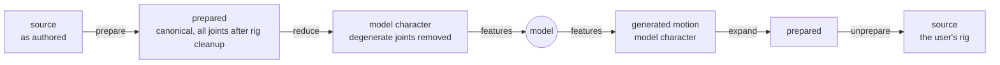

# Data round trip: from the user's rig and back onto it

A character goes in as the vendor or user authored it. It comes back out, after
the model has generated or retargeted motion for it, **on that same
character**: the same joint names, hierarchy, units, channel layout, bind pose
and, for FBX, mesh. Everything between the two ends is allowed to be canonical
and reduced, because every step that changes the character records how to
undo itself.

That promise is why preparation is a chain of invertible stages rather than a
preprocessing script, and why the corpus keeps every joint that rig cleanup
(`prune_unskinned`) did not remove, even though the model sees fewer. Without it, PoseYdon would be a benchmark rather than a tool
anyone can hand a rig to.



## Three levels

| level | joints | geometry | lives in |
|---|---|---|---|
| **source** | as authored | as authored | `data/_raw/truebones/source/<Rig>/` |
| **prepared** | source, less any rig cleanup (`prune_unskinned`) | bind removed, root promoted, faced +Z, rigid, centred, scaled, grounded | `data/truebones/clips/<Rig>/` |
| **model** | zero-length bones removed | as prepared | features, `skeleton.npz` |

Preparation changes geometry, and may clean up the rig (a stage such as
`prune_unskinned` removes joints and records them); reduction is the model's
lens: it changes structure and keeps geometry. The owner kept them as two
lists, `prepare:` and `reduce:`, because separate groups keep the operations
logically distinct instead of one giant list. That also lets one prepared
corpus serve several feature layouts, keeps the prepared level a full-character
artifact with its own round-trip check, and means changing `reduce:` reruns
stage 2 only ([build: preparation](../api/build/preparation.md#rig-cleanup-versus-the-models-lens)).

## Going in: preparation

The dataset config's `prepare:` list (`configs/data/truebones.yaml`) is the
single definition of the stage order, built by
[`chain_from`][poseydon.build.prepare.chain_from] and checked against each
stage's declared predecessors. Each stage implements `fit`, `apply` and
`invert`; what it fitted, and the list itself, are saved to
`rigs/<Rig>/preproc.npz`. Inversion rebuilds the chain from that saved list,
reads the saved parameters and never refits. The stages Truebones lists:

| # | stage | scope | what it does | what undoing it needs |
|---|---|---|---|---|
| 1 | [`UpAxis`][poseydon.build.UpAxis] | rig | turns the manifest's `up_axis:` (default +Y) to +Y | the declared axis |
| 2 | [`RestRelative`][poseydon.build.RestRelative] | rig | removes the per-joint bind rotation Biped exporters bake into every clip, so identity means the rest pose | the rest pose's bind rotations |
| 3 | [`PromoteRoot`][poseydon.build.prepare.PromoteRoot] | rig | moves the root off a ground locator, or off static FBX nodes above the body, onto the first body joint (18 of 73 Truebones rigs) | the removed chain above the new root, and any dead branch off it, back at their rest pose |
| 4 | [`EnforceRigid`][poseydon.build.EnforceRigid] | rig | drops non-root translation so bone lengths are constant | the source's channel declaration, which the writer restores |
| 5 | [`FaceRestAxis`][poseydon.build.FaceRestAxis] | rig | turns the whole rig so its rest skeleton faces +Z | the rest pose's yaw |
| 6 | [`FaceAxis`][poseydon.build.FaceAxis] | **clip** | turns the clip's root so its frame-0 facing points along +Z; offsets and every other joint's rotation are left alone | that clip's yaw, which can't be recovered from the prepared file |
| 7 | [`CentreXZ`][poseydon.build.CentreXZ] | rig | puts the root at the XZ origin on the rest pose's first frame | the offset |
| 8 | [`ScaleToMeanBoneLength`][poseydon.build.ScaleToMeanBoneLength] | rig | scales so the mean bone length matches the reference's SMPL mean | the scale factor |
| 9 | [`PutOnGround`][poseydon.build.PutOnGround] | rig | puts the rest pose on y = 0: its lowest mesh vertex (`mode: mesh`, from `rest_mesh.npz`) or lowest joint (`mode: joints`, or a manifest's `ground: joints`) | the offset |
| 10 | [`BoneRelative`][poseydon.build.BoneRelative] | rig | only in `data=truebones_bone`: re-expresses every local rotation in a bone-aligned frame, so identity is a straight chain | the per-joint frames |

`data=unimate` lists UniMate's own variants of this chain instead: `up_axis`,
`prune_unskinned`, `bfs_order` (rig; renumbers joints breadth-first; undone with
the stored permutation), `enforce_rigid` (drop), `face_axis` (`on_degenerate: nearest`), `centre_xz_clip`
(**clip**; the clip's own frame-0 root XZ), `scale` (`mode: diameter`, 2.0) and
`ground_clip` (**clip**; the clip's own lowest joint over all frames). No
`rest_relative`, `face_rest_axis` or `promote_root`.

**Rig scope versus clip scope** decides what survives. Rig stages fit once on
the rest pose and are shared by every clip of the character. Fitting
grounding per clip would put a flying creature on the floor and erase the
height difference between a crouch and a stand. `FaceAxis` is the only clip
stage of the Truebones chain, so it is the only parameter recorded per clip
(`data=unimate` adds `centre_xz_clip` and `ground_clip`).

You run preparation with `scripts/process_dataset_truebones.py`. Truebones and
UniMate's recipe both read FBX at stage 1, through the cache (`fbx_cache`): motion and
mesh come from one file, and each Truebones rig's rest pose is the one its rest
asset holds: the manifest's `rest_pose:`, on the vendor FBX and its bind
(`tools/build_rest_fbx.py`). A `bvh_files` source runs on the BVH only and has no
FBX export. Each rig also gets a
`report.json` recording what was done and why. See [build: preparation](../api/build/preparation.md).

## The model's view: reduction

A zero-length bone moves nothing. Truebones rigs carry ten or more per
character: every End Site, plus the odd dummy. `src/poseydon/features/reduce.py`
handles them in two ways:

- a zero-offset **leaf** is deleted outright, losing nothing;
- a zero-offset **internal** joint is folded into its parent only when it is
  that parent's only child. Otherwise folding would turn its siblings, so the
  joint is kept;
- a **still** joint, one that turns less than the `drop_still` rule's
  `degrees` (`reduce:` in the dataset config) over every clip of its rig, with every joint below it,
  is deleted whatever its length and comes back at its constant rotation
  (3ds Max `*Nub` tip bones, never-animated lips and eyes, Rat's `Trajectory`).

Reduction is applied **when features are read, never written into the
corpus**. A generated clip has to land back on the rig, so the corpus keeps
every joint that rig cleanup (`prune_unskinned`) did not remove. The
recorded [`JointReduction`][poseydon.features.reduce.JointReduction] is replayed in reverse by [`invert_reduction`][poseydon.features.reduce.invert_reduction]. See
[features: reduction](../api/features/reduction.md).

## Coming back: export

`RigRecord` in `src/poseydon/export/rig.py` holds what the corpus recorded
about one rig and moves a clip between spaces; the file format then writes
whatever clip it is given:

```python
record = RigRecord.load(corpus, "Dog")
prepared = record.expand(model)                       # every joint (after rig cleanup), canonical
source = record.restore(model, facing_from="attack")  # the user's rig

BVH.from_animation(source, channels=record.source_channels).write("dog.bvh")
FBX.from_animation(source, record.asset).write("dog.fbx")
placed, space = record.placement(model, facing_from="attack")
FBX.from_animation(placed, record.asset, space).write("dog_prepared.fbx")
```

| space | joints | frame | BVH | FBX |
|---|---|---|---|---|
| **model view** | exactly the model's | canonical (+Z, scaled, centred, grounded) | the animation | expand first |
| **prepared** | every joint (after rig cleanup) | canonical | the animation | the rest asset in canonical space, mesh included |
| **source** | the source's own | source units, frame, names, channels | with the source's `CHANNELS` block | the rest asset: the vendor's nodes, mesh, skin, materials and bind |

Every FBX carries the vendor's mesh on its own bind. A source BVH needs
`source_channels` and an FBX needs the rest asset (and, for canonical space, the
placement), because neither is in an animation. The source clip is in the asset's
own space, so its joints drive the asset's nodes by name: there is no calibration.

**FBX export needs no calibration.** Motion is read from the vendor FBX
(`fbx_cache`), and the rest asset is that FBX held in the rest pose
(`tools/build_rest_fbx.py`), so a restored clip is already in the asset's space.
The writer drives nodes by name through the Autodesk FBX SDK, holding the
joints `RigRecord.fixed` lists at the asset's rest transform. All 73 Truebones
rigs export; the old Blender path refused 13. See
[export](../api/export/index.md).

`poseydon export` takes a generated clip as `.anim.npz` or `.bvh`. Prefer the
`.anim.npz` that `sample` and `retarget` write beside each BVH: it is the
animation exactly as generated, while the BVH rounds to 6 decimals and has no
rotation for a leaf of the model view. BVH output runs anywhere; FBX output needs the `fbxsdk` container.

```bash
docker compose run --rm test python -m poseydon.cli export samples/Scorpion__clip.anim.npz \
    --rig Scorpion --representation source --format bvh --out scorpion.bvh
docker compose run --rm fbxsdk python -m poseydon.cli export samples/Scorpion__clip.anim.npz \
    --rig Scorpion --representation source --format fbx --out scorpion.fbx
```

**Facing.** A generated clip never had a facing of its own. With no
`--facing-from`, the exporter restores the **rig's** facing, the one recorded
for the rest pose. With `--facing-from <action>`, it restores that recorded
clip's yaw instead. If the rig's facing was never recorded, export raises an
error rather than substituting an identity rotation. That identity fallback
was removed because it moved reinserted roots by 22–167% of the rig's extent.

**Refusals.** Export fails loudly, never silently, when the generated topology
doesn't match `skeleton.npz`, when a transform is missing, or (FBX) when the
rig has no rest asset or no joint names a node of it.

## What it loses on purpose

The round trip is exact wherever the contract allows, and lossy in a few
places by design. All numbers below come from the 2026-09-28 audit.

- **Per-joint translation** that the source animated is dropped by
  `EnforceRigid`. That is real motion, roughly 10% of skeleton size on raw
  Truebones, and it is the price of a rigid skeleton.
- **One rigid geometry per rig.** Per-clip bone vectors are replaced by the
  rest clip's. On some attack clips joints come back up to 15% (Dog) and 25%
  (Horse) of the extent away from the raw source. About 2.9% of rigid
  joint-clips come back with a different constant bone vector, mostly props
  and locators.
- **Removed locators above the root** come back at a constant pose.
- **Joints removed by rig cleanup** (`prune_unskinned`, `data=unimate` only:
  unskinned controls, helpers, locators) come back at their bind pose with no
  motion. The children of a merged or folded joint land exactly where they were;
  the removed joint itself is not its source motion. `test_round_trip` checks it
  to a stated bound (see the [testing guide](../how-to/testing.md)).
- **Twist on a reduced joint is gone.** For example, Bear's zero-offset but
  skinned forearm-twist bones leave the forearm skin up to 5.5% of the mesh
  extent off.

## How it's verified

| check | what it proves |
|---|---|
| `tests/test_roundtrip.py::test_round_trip` | for every prepared clip of a dataset (`--dataset truebones` or `unimate`): features rebuild the model view in both rotation layouts, and the restored clip written to disk matches the **raw source**, read through the dataset's `source:` and cut to the kept frames, in names, hierarchy, frames, root trajectory and every observable world rotation, with rigid bones; for a BVH source also `CHANNELS` and offsets; removed joints to a stated bound |
| `tests/test_roundtrip.py::test_round_trip_fbx` | the restored clip written onto the rest asset holds the **source FBX**'s root position and the orientation of every kept joint, leaves included, to 1e-4, with the asset's node scale and hierarchy; prepared and model FBX, on the same asset in canonical space, read back with the prepared joint positions (the model view: its expansion's) (`fbxsdk` container) |
| `scripts/build_stage_samples.py` | one clip per rig at every stage (source, prepared, model, roundtrip), as BVH and FBX, under `tmp/truebones/<Rig>/`, to open side by side |

```bash
docker compose run --rm -T test python -m pytest -q tests/test_roundtrip.py --dataset truebones -k Camel
docker compose run --rm -T fbxsdk python -m pytest -q tests/test_roundtrip.py --dataset truebones -k Camel
```

When checking a round trip by hand, compare against an **independent**
reference: Blender's stock BVH importer, the vendor's own per-action FBX, or
the raw file text. A reference built from the pipeline's own formulas or
manifest facing pairs agrees with the pipeline by construction and proves
nothing.

## Open issues

None open as of 2026-10-13. Update this section when one is found.

By design: a model view written as BVH has no rotation for its leaves (a BVH
leaf has no channels): Dog's ears, tail tip and toes, for instance. The model
sees those rotations and `RigRecord.restore` brings them back, so only the
model-view `.bvh`, a debug output, lacks them; export from the `.anim.npz`
beside it. See [export](../api/export/index.md).

Fixed on 2026-10-13: facing is two stages. `FaceRestAxis` turns each rig
once so its rest skeleton faces +Z, and `FaceAxis` turns each clip's root so
frame 0 faces +Z. `FaceAxis` used to turn the whole rig per clip, which gave
each clip its own offsets and its own frame for every local rotation, so the
same pose had different rotation features in different clips. Both now run
after `EnforceRigid`; measured before it, frame 0 of some Biped clips came
out up to ~90° off +Z.

Also fixed on 2026-10-13: the model now sees every rotation it can be asked to
generate. The default `rot6d_joint` layout stores each joint's own rotation,
and under `rot6d_bone` the reduction keeps the End Site that carries a
parent's rotation ([features: reduction](../api/features/reduction.md)).

The `PromoteRoot` joint-index fix and the BVH writer's depth-first and
channel-layout fixes landed on 2026-10-12; see [build: preparation](../api/build/preparation.md)
and [io](../api/io/index.md).

## Where to read further

- [build: preparation](../api/build/preparation.md): the stages, [`RigTransform`][poseydon.build.prepare.RigTransform],
  `preproc.npz`
- [features: reduction](../api/features/reduction.md): reduction and expansion
- [export](../api/export/index.md): [`RigRecord`][poseydon.export.rig.RigRecord]
- [io](../api/io/index.md): what BVH and FBX can and can't carry
